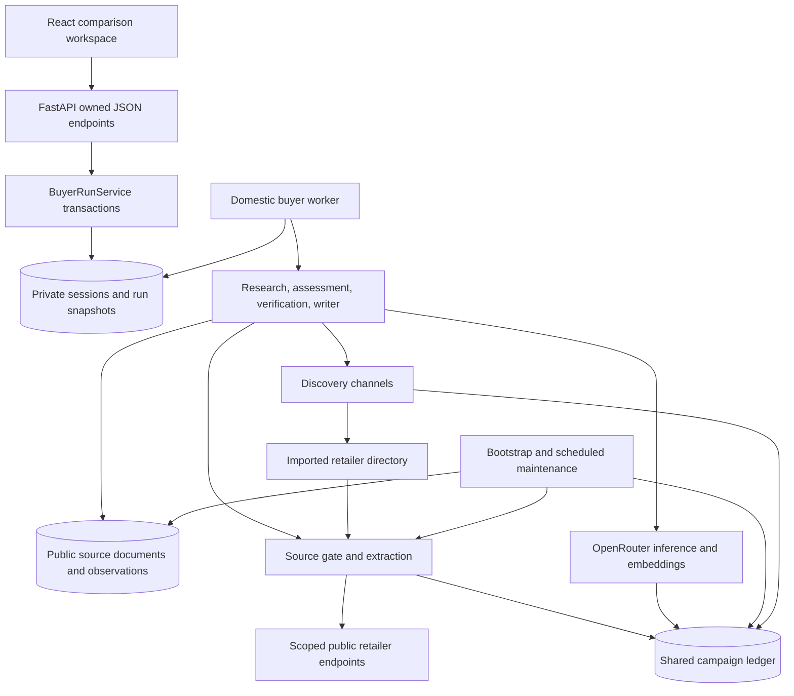

# Architecture, API and reproducibility report

The implementation described here is the domestic buyer application at commit `e3e6aa7`. Evidence dates refer to the individual source checks. The final release commit and its rehearsal are tracked in #85. The [November 17 checkpoint](https://github.com/han33-dotcom/TechScout/blob/733dae7e4c1317e8da0f9b916f576eb6a16ba1f4/docs/architecture-api-report.md) preserves the earlier architecture. [Report issue](https://github.com/han33-dotcom/TechScout/issues/83)

## Product scope and implementation status

TechScout supports phones, laptops, tablets, monitors and headphones or earbuds. A buyer can identify a model, paste a retailer listing or describe their needs. Purchase offers require local pickup or dispatch from inside Lebanon. New condition is the default. Other conditions require an explicit choice. Historical international comparisons remain available in private history. Purchases take place on the retailer's site. [Scope decision](https://github.com/han33-dotcom/TechScout/issues/155)

| Component | Implemented behavior | Evidence and limits |
| --- | --- | --- |
| Browser and API | Typed React workspace, owned runs, polling, cancellation, refinements, pickup branch selection and private history | A browser rehearsal with fixture retailers verified that changing only a branch could remove a pickup offer. The buyer walkthroughs require participant sessions. [Walkthroughs](buyer-walkthroughs.md) |
| Buyer worker | A listing link follows one retailer and variant. Exact-model search seeks two independent sellers of one configuration. A needs search evaluates up to three distinct models and groups sellers within each model. | All five categories and both exact and needs entry passed offline. A live H30i request checked two local sellers in 9.235 seconds. Neither had sufficient evidence for a payable total. [Buyer demo](domestic-buyer-demo.md) |
| Public corpus and acquisition | The bootstrap, three maintenance jobs and technical onboarding share source admission and accounting with buyer research. | One live maintenance batch added three listing prices. It added no qualifying domestic comparison. [Maintenance receipts](catalog-refresh.md) |
| Model access and discovery | OpenRouter serves the buyer's model roles and the embedding route. Five discovery channels can supply leads. | The manufacturer directory, SerpApi, Brave and Firecrawl Search returned live results in the paired language checks. The provider table below gives the measured coverage. [Calibration](development-calibration.md) |
| Evaluation | Versioned cases, isolated baseline runners, adjudication and scoring. | All 27 development requests ended in abstention. The held-out report covers 23 domestic requests and four configurations. Buyer walkthroughs with participants remain outstanding. [Held-out results](evaluation-report.md) · [Protocol](evaluation-protocol.md) |

## Process and module boundaries

The application is a modular Python backend with a separate React frontend. API
and worker processes share Python modules and durable database state. Ordinary
role calls are function calls, not internal HTTP services. The checked-in Compose
stack runs PostgreSQL, a one-shot migration service, the API and an ingestion
**heartbeat** process. The heartbeat checks database/evidence-volume availability;
it does not claim or execute collection jobs. A buyer worker is a separate explicit
entry point. Run the buyer worker and opt-in maintenance scheduler separately from the Compose heartbeat.



| Responsibility | Code and contract |
| --- | --- |
| HTTP admission and ownership | `app/buyer_api.py`, `app/buyer_runs.py`; handlers stay thin over service transactions |
| Buyer execution | `app/run_worker.py`; `app/buyer_flow.py` and `app/domestic_buyer.py` execute the leased `RunContext` |
| v2 contracts and role interfaces | `app/contracts_v2.py`, `app/contract_interfaces.py`; request/run revisions and typed evidence |
| Research | `app/research_workers.py`, `app/research.py`; stored evidence first, bounded scoped gaps and discovery |
| Domestic search planning | `app/domestic_search_plan.py` builds eligible queries for the remaining coverage gap. The pinned buyer model selects a query and a configured channel. The controller handles dispatch, outages and final checks. |
| Deterministic decisions | `app/identity.py`, `app/assessment.py`, `app/costs.py`, `app/verification.py` |
| Grounded explanation | `app/writer.py`; evidence-backed claims and deterministic fallback |
| Acquisition | `app/sources.py`, `app/source_capabilities.py`, `app/page_extraction.py`, `app/adapters/` |
| Durable public knowledge | `app/corpus.py`, `app/freshness.py`, `app/retrieval.py`, `app/embeddings.py`, `app/directory.py` |
| Spend/workload control | `app/accounting.py`; cross-process reservations, source leases and campaign limits |

This boundary keeps the small project deployable without a distributed broker or
per-agent services. Database locks serialize short claims/state transitions and
are released before network work. The ledger currently uses a serialized campaign
row: simple to audit at the configured scale, but a potential contention point at
larger volume. Split services or migrate the ledger to indexed attempt tables only
after measuring workload and contention. A graph database is not required by the
current exact-field, relational, text and vector queries.

## Request, evidence and decision flow

1. The browser constructs a v2 `ShoppingRequest` and exposes its interpreted
   constraints for editing. Approximate budgets remain preferences; explicit
   maxima are hard limits. A buyer can edit a city, fulfillment mode or pickup branch before submitting a revision.
2. The API persists the owned request and queues a run. It returns immediately;
   polling retrieves durable state rather than holding an HTTP request open for
   the execution budget. A configured worker claims the run and receives its
   remaining active time and cancellation checks.
3. Research modules retrieve scoped existing evidence and consult the directory.
   Exact product, variant, route, branch and field filters constrain retrieval
   before similarity ranking. An LLM may order permitted work; it cannot admit a
   source, invent an action, relax buyer constraints or allocate extra budget.
4. Public reads pass the registry, network/source gate and ledger. Extraction
   emits typed observations and immutable provenance. Shared HTML/JSON-LD parsing,
   dedicated retailer readers and explicitly enabled Firecrawl reuse this path.
   Page text is untrusted data and cannot invoke tools.
5. Deterministic matching, eligibility and cost checks assess the resulting facts.
   Prices use Decimal. Missing mandatory charges stay unknown, conflicting
   evidence stays conflicting, and a delivery estimate is not a guarantee.
6. Provisional stored candidates may be published with original observation times.
   Main recommendations require current-run price/stock checks and complete
   eligibility/cost evidence. Only up to three eligible recommendations are
   displayed; fewer or none is a valid result.
7. A refinement creates a new request revision/run. Old results remain separate
   from the current workspace; late callbacks cannot mutate cancelled or superseded
   results. Explanation modules cannot fill gaps with plausible prose.

In the live H30i example the seed corpus provided candidates, then the worker obtained current price and stock from both sellers. Dispatch evidence applied to the exact listings. Missing condition, purchasability, fees or destination eligibility kept their item prices outside the main recommendations. The seeded corpus, result rules and separate buyer process can be exercised together with the [domestic buyer scenarios](domestic-buyer-demo.md).

## Storage, provenance and freshness

PostgreSQL is the supported database; SQLite provides an offline fixture path.
Alembic revisions `0001`–`0009` add the original records, pgvector, public corpus,
retirements, embedding usage, retailer directory, shared accounting, owned buyer sessions/runs and retailer onboarding. Contract JSON accompanies queryable relational columns.
Private buyer requests and history are not indexed into the public corpus.

Public resources retain source URL, exact product/variant/branch/route scope,
original observation time, raw-response SHA-256, field excerpt/locator and
corpus/extraction/chunk/index versions. Snapshots live under `EVIDENCE_DIR` with
restricted permissions, are checked against their hashes, and are not served as
public HTTP files. Keep database and evidence-volume backups together.

PostgreSQL full-text search uses the GIN `simple` index; pgvector uses cosine
distance. Reciprocal-rank fusion combines at most 200 keyword and 200 vector
candidates into at most 20 hits after scope/version filtering. SQLite's bounded
text/vector fallback verifies mechanics, not production recall. Embedding calls
are explicit, versioned and metered; reindexing does not refresh source facts.

Default reuse ages are 30 days for specifications and 7 days for general policies,
with earlier explicit expiry and conflict/retirement checks. Item quotes require
their exact route/package context and expiry. Price and stock still need current
run verification. HTTP 304, unchanged pages and new extraction/index versions do
not reset original observation ages. See [evidence services](evidence-services.md).

## Owned API and UI state

`GET /api/session` creates/reuses a 24-hour session and returns a CSRF token. The
cookie is HttpOnly and SameSite=Strict; only its hash is persisted. Secure cookies
are the backend default. Local HTTP needs `TECHSCOUT_COOKIE_SECURE=0`; Compose
already supplies that local default. HTTPS deployments use `1` and trusted proxy
scheme/host forwarding. All mutations require the exact `Origin` and
`X-CSRF-Token`. Cross-session guessed run IDs return 404, and API responses are
`Cache-Control: no-store`.

| Endpoint | Behavior |
| --- | --- |
| `POST /api/runs` | v2 request with revision 1; returns 202 `RunSnapshot` |
| `GET /api/runs/{run_id}` | Owner's `ComparisonWorkspace`, including current and previous revisions |
| `POST /api/runs/{run_id}/clarify` | Complete `run`, `clarification_id`, bounded `answer`; 202 resumed snapshot |
| `POST /api/runs/{run_id}/cancel` | Complete `run`; terminal cancellation is idempotent |
| `POST /api/runs/{run_id}/refine` | Complete `run` plus next-revision `request`; 202 workspace |
| `GET /api/history?limit=20` | Latest owned search revisions, maximum 20 |
| `GET /api/history/{run_id}` | Historical workspace; reopening does not resume/reverify |
| `POST /api/history/{run_id}/delete` | Delete all owned request revisions; cancel active work first |
| `GET /api/history/{run_id}/export?include_evidence=true` | Sanitized historical plain-text download |

Error contracts distinguish 401 session expiry, 403 origin/CSRF, 404 unknown or
unowned run, 409 stale revision/active deletion, 413 payload over 64 KiB, 422
invalid input and 429 admission capacity. Default limits are one active run per
session, 20 globally and two running controllers. Worker leases last 15 seconds;
expired work becomes partial rather than being automatically replayed. The
120-second active allowance spans clarification resumes; queued/human wait time
does not count or replenish it. Threads cannot forcibly cancel an already-sent
remote request, but late publication is rejected.

`frontend/src/useWorkspace.ts` owns the selected workspace, mutation lock and
poll generation. Superseded polls are aborted, responses are revision-checked,
and ambiguous mutations are not automatically retried. History is visibly
historical. Export omits private identifiers, request text, destination details,
credentials and raw excerpts. Session expiry denies access immediately; physical
cleanup is opportunistic, not a scheduled deletion SLA. Backup retention is an
operator responsibility. See [history](buyer-history.md).

The frontend is **React + TypeScript + Vite**, with generated OpenAPI types and a
same-origin client. It supersedes the earlier template-page proposal; there is
no Streamlit application. Development Vite proxies `/api`, `/health` and `/sources`
to FastAPI. Production serves compiled assets from FastAPI; the SPA fallback must
not turn missing API/evidence/asset paths into successful HTML responses.

### Executable local API example

With a migrated local API listening on port 8000 and local HTTP cookies enabled,
run this in PowerShell. It queues, polls and cancels a synthetic request. It makes
no provider call by itself; do not run it against a worker configured for live
shopping if you intend an offline lifecycle demonstration.

```powershell
$base = 'http://127.0.0.1:8000'
$session = Invoke-RestMethod "$base/api/session" -SessionVariable buyerSession
$headers = @{ Origin = $base; 'X-CSRF-Token' = $session.csrf_token }
$request = @{
  schema_version = 2; request_id = [guid]::NewGuid().ToString(); revision = 1
  intent = @{ kind = 'exact_model'; model = 'Synthetic Laptop' }
  requirements = @{ category = 'laptop'; min_ram_gb = 16; min_storage_gb = 512 }
  budget = @{ maximum = @{ amount = '1200.00'; currency = 'USD' } }
  fulfillment = @{ mode = 'delivery'; destination = @{ country = 'LB'; city = 'Beirut' } }
}
$run = Invoke-RestMethod "$base/api/runs" -Method Post -WebSession $buyerSession `
  -Headers $headers -ContentType 'application/json' -Body ($request | ConvertTo-Json -Depth 12)
$workspace = Invoke-RestMethod "$base/api/runs/$($run.run.run_id)" -WebSession $buyerSession
$workspace.current.status
Invoke-RestMethod "$base/api/runs/$($run.run.run_id)/cancel" -Method Post `
  -WebSession $buyerSession -Headers $headers -ContentType 'application/json' `
  -Body (@{ run = $workspace.current.run } | ConvertTo-Json -Depth 12)
```

Without a configured controller the poll returns `queued`, then cancellation
returns `cancelled`. `/openapi.json` is the authoritative response schema. Use the
latest full run reference for cancellation/clarification/refinement; a stale
reference is an error, not permission to overwrite newer work.

## Providers and shared accounting

The domestic worker injects an OpenRouter provider for each model-driven role. It loads its approved settings from `var/inference.json` or `TECHSCOUT_INFERENCE_CONFIG`. The development series pinned `openai/gpt-6.1-sol` to the OpenAI serving provider, with distinct role and writer prompt versions. A development evaluator produced a schema-valid response. The same backend `OPENROUTER_API_KEY` reached `openai/text-embedding-3-small` for indexing and query embeddings at 1,536 dimensions. Stored vectors must match the routed index version. Structured and keyword retrieval remain available when vectors are missing. [Measured route and limits](development-calibration.md) · [Inference configuration](live-flow.md)

The historical direct-provider paths remain in the tree. The v1 `python -m app.runs search REQUEST.json --planner model` uses `OpenAIPlanner`. Constructing the standalone writer without an injected provider also defaults to `OpenAIProvider`. `AnthropicPlanner` remains in `app/planner.py`. The domestic worker constructs and passes its OpenRouter provider explicitly. Provider credentials stay in the backend.

On November 24 the production buyer and all four study configurations ran development case C02 on separate PostgreSQL clones. The configured model selected a localized Samsung Galaxy S25 query in the production, full and single-agent runs. The fixed baseline selected the default query through the rule planner. SerpApi returned leads after Tavily refused each request. All five runs abstained because no offer passed verification. The ledger recorded USD 0.003688 across the five runs. [Development run receipts](domestic-search-planning-2026-11-24.json)

| Discovery channel | November 23–24 development measurements |
| --- | --- |
| Manufacturer directories | Ten gated reads of the reviewed ASUS page across paired Arabic and English objectives. Five distinct retailer identifiers, zero qualifying comparisons. |
| Tavily | Ten search attempts were refused. The separate account usage endpoint returned HTTP 403. |
| SerpApi | Ten dispatched searches, nine successful responses and one timeout. The free account allowance decreased by ten searches. |
| Brave Search | Ten successful searches. The ledger retained USD 0.050 in reservations pending billed usage. |
| Firecrawl Search | Ten successful searches using 20 included credits. |

Each channel returns leads. A background technical check can admit a scoped capability, and an admitted retailer still needs current evidence for a buyer recommendation. Firecrawl's separately priced page-read fallback is distinct from Firecrawl Search. The SerpApi and Firecrawl series found 34 distinct lead identifiers and zero qualifying comparisons. The Brave and Tavily series also returned zero qualifying comparisons. [Discovery configuration](discovery.md) · [Channel receipts](development-calibration-2026-11-23.json)

Metered processes use one provisioned PostgreSQL campaign ledger, configured through `TECHSCOUT_ACCOUNTING_URL`, independent of their application database. The Compose example supplies a local app stack. Configure the shared ledger separately for operational buyer and collection processes. Each external attempt reserves capacity before dispatch. Uncertain usage retains its allowance. The overall budget is USD 500. Initial collection is capped at USD 50 and maintenance at USD 3 per used UTC day, up to USD 42 over fourteen days. Buyer runs have a 120-second active limit, 40 external calls and a USD 1 ceiling. At the recorded calibration checkpoint the ledger accounted for USD 3.03707574 across devices. [Accounting deployment](local-accounting.md) · [Budget and workload rules](shared-accounting.md)

## Directory, collection and corpus reproduction

Run `python -m app.directory import-seeds` after migration to import the domestic audit and known listing sellers offline. The directory records coverage and source identity. The registry governs each allowed endpoint, capability and workload. Automatically proposed retailers enter that same technical review. [Directory](retailer-directory.md) · [Onboarding](retailer-onboarding.md)

For bounded collection, `python -m app.bootstrap config/domestic-bootstrap-validation.json` uses a versioned manifest with a stable job ID. Reuse the same application database, evidence directory, manifest and shared ledger to resume it. Keep its configuration hashes, source and variant IDs, page outcomes, observation times, corpus/index versions and actual spend with the run. The November 23 H30i seed had exact listings at two sellers. Names from other catalogs provide discovery leads. [Bootstrap instructions and receipts](catalog-bootstrap.md)

The opt-in scheduler starts paused. `python -m app.maintenance status` inspects it. After explicit enablement, `python -m app.maintenance serve` runs discovery at startup and daily, rotates catalog scans every six hours and processes due offer checks. High-use offers rotate every 12–24 hours and other useful offers every 3–7 days. A manual trigger uses the same lease and campaign limits. Pause stops new dispatches. Conditional reads and changed-content checks preserve original observation times. An incomplete catalog alone cannot establish product removal. [Scheduler commands and recovery](catalog-refresh.md)

In the bounded November 23 run, three retailer leads entered validation, ten headphone product URLs were enumerated and three newly enumerated listings yielded exact prices. Nine external calls settled at USD 0.00088698. Three pages were still due. The schedule was paused after the demonstration. The buyer worker continues to check finalists during each request. [Job records](catalog-refresh.md)

## Setup, versions and validation

Use a fresh checkout and Python 3.11. Follow [collaborator setup](collaborator-setup.md)
and the [README](../README.md) for complete host/Compose and paired recovery commands.
For an offline local database, leave provider keys absent and run from the root:

```powershell
py -3.11 -m venv .venv
.\.venv\Scripts\Activate.ps1
python -m pip install -r requirements.txt
python -m alembic upgrade head
python -m app.storage load-fixtures
python -m app.directory import-seeds
npm --prefix frontend ci
npm --prefix frontend run build
$env:TECHSCOUT_COOKIE_SECURE = '0'
python -m uvicorn app.main:app --host 127.0.0.1 --port 8000
```

With `DATABASE_URL` unset, the host uses local SQLite. For PostgreSQL export the application DSN in the API and worker shells and use a shared `EVIDENCE_DIR`. The worker's normal entry point is `python -m app.run_worker --controller app.buyer_flow:run`. It loads named provider settings from the repository-root backend environment file. A live run also needs the central accounting settings. The earlier single-source demonstration uses `app.buyer_flow:run_checkpoint`. FastAPI serves built assets after restart. [Buyer API and worker setup](buyer-api.md)

| Component | Pinned/configured checkpoint |
| --- | --- |
| Backend runtime | Python 3.11; Docker `python:3.11-slim` tag is not digest-pinned |
| Python dependencies | `requirements.txt`: Pydantic 2.13.5, FastAPI 0.143.0, SQLAlchemy 2.1.4, Alembic 1.20.0, psycopg 3.3.6, pgvector 0.5.1 |
| Database | PostgreSQL 17 / pgvector 0.8.2 image, digest pinned in Compose and CI |
| Frontend | React 19.2.9, TypeScript 5.9.3, Vite 7.3.8; resolved tree in `frontend/package-lock.json` |
| Node | Docker 24.14.1 digest-pinned; CI Node 22; package minimum 22.12 |
| Model configuration | `config/evaluation.json`: evaluation inference pins OpenRouter `openai/gpt-6.1-sol` on OpenAI, `roles-v1` and `writer-v1` |
| Embeddings | OpenRouter `openai/text-embedding-3-small`, 1,536 dimensions, configured price and index version |

Record the actual commit, interpreter/package versions, image digests, configuration
hashes and corpus/index versions with each evaluation. Pinned package lists do not
pin the external provider implementation or retailer pages. Model/routing changes
must be labeled separately from the main evaluation. Offline synthetic assertions
are not held-out metrics, source availability measurements or provider bills.

Required PR checks are `test` and `build`. CI runs frontend interactions/typecheck/
production build, the Python suite on SQLite and PostgreSQL, PostgreSQL migrations/
fixture loading, and a disposable Docker build/restart/backup/restore rehearsal.
Local equivalents are:

```sh
python -m unittest discover -s tests -v
npm --prefix frontend test
npm --prefix frontend run build
python scripts/check_local_stack.py
```

`TEST_DATABASE_URL` must point only to a disposable database: the tests reset its
schema. The Docker rehearsal creates disposable projects; it does not validate
live retailer/provider access. Record exact results and unavailable checks in the
PR. No live network call is needed for ordinary fixtures.

The most recent buyer-UI checkpoint passed 1,099 Python tests on SQLite and again on PostgreSQL, 30 frontend tests and the Docker build/recovery checks. The PowerShell lifecycle example also ran against a fresh, migrated SQLite database with a loopback API and no buyer worker. It returned a queued run, polled its owned workspace and cancelled it. The operator browser rehearsal used synthetic source pages and model replies. The dated buyer demo and development calibration document the separate live observations. [CI evidence](https://github.com/han33-dotcom/TechScout/actions/runs/45275157051) · [Browser rehearsal](buyer-walkthroughs.md)

## Release handoff and remaining evidence

At release, repeat the lifecycle example and offline checks on the exact release commit. Record the code and config hashes, model route, corpus and index versions, migration revision and backup/restore results. Link the actual buyer sessions, held-out results and primary/recovery laptop rehearsals alongside the five-channel calibration receipts. The first qualifying live browser result also remains open. [First qualifying result](https://github.com/han33-dotcom/TechScout/issues/75) · [Calibration](https://github.com/han33-dotcom/TechScout/issues/80) · [Release rehearsal](https://github.com/han33-dotcom/TechScout/issues/85)
