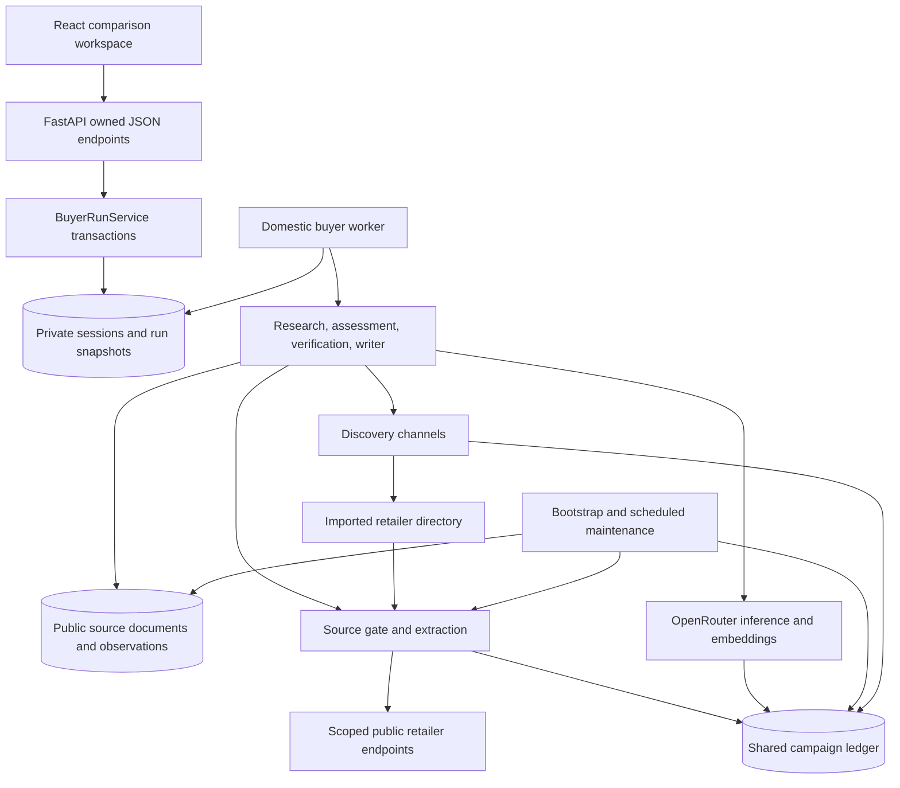

# Architecture, API and reproducibility

This is the domestic buyer baseline. The [experiment record](buyer-architecture-comparison.md) identifies the control revision, its measured outcomes and the single-agent implementation planned for comparison.

## Process and module boundaries

The React workspace submits an owned request to FastAPI. A separate buyer worker claims it from the database and publishes results for the browser to poll. Revisions preserve the previous result. Compose starts the database, migrations, API and ingestion heartbeat. Buyer execution and scheduled collection each have their own entry point.

| Responsibility | Code and contract |
| --- | --- |
| HTTP admission and ownership | `app/buyer_api.py`, `app/buyer_runs.py`; handlers stay thin over service transactions |
| Buyer execution | `app/run_worker.py`; `app/buyer_flow.py` and `app/domestic_buyer.py` execute the leased `RunContext` |
| v2 contracts and role interfaces | `app/contracts_v2.py`, `app/contract_interfaces.py`; request/run revisions and typed evidence |
| Research | `app/research_workers.py`, `app/research.py`; stored evidence first, bounded scoped gaps and discovery |
| Domestic search planning | `app/domestic_search_plan.py` builds eligible queries for the remaining coverage gap. The pinned buyer model selects a query and a configured channel. The controller handles dispatch, outages and final checks. |
| Deterministic decisions | `app/identity.py`, `app/assessment.py`, `app/costs.py`, `app/verification.py` |
| Grounded explanation | `app/writer.py`; evidence-backed claims and deterministic fallback |
| Acquisition | `app/sources.py`, `app/source_capabilities.py`, `app/page_extraction.py`, `app/adapters/` |
| Durable public knowledge | `app/corpus.py`, `app/freshness.py`, `app/retrieval.py`, `app/embeddings.py`, `app/directory.py` |
| Spend/workload control | `app/accounting.py`; cross-process reservations, source leases and campaign limits |

## From request to recommendation

1. Interpret the buyer's model, destination and constraints. Search the catalog and choose a scoped discovery or retailer action for missing facts.
2. Store observations against the selected variant, retailer, field, URL and observation time. Public evidence is reusable. Buyer requests and session history are private.
3. Apply identity, eligibility and cost rules. Recheck finalist price and stock in the current run. A missing mandatory charge leaves the delivered total unknown.
4. Publish checked offers, partial results and outstanding questions. The writer selects from evidence-backed claims. A refinement creates a new request revision. [Buyer API and lifecycle](buyer-api.md) · [Storage contracts](full-product-contracts.md) · [Writer](writer.md)

## Reproduce and verify

Use the [local setup and recovery guide](local-development.md), start the [buyer worker](buyer-api.md), and provision the [shared ledger](shared-accounting.md) before a live run. The [source coverage record](source-coverage.md) distinguishes a working reader from a verified offer. The [dated checkpoint report](https://github.com/han33-dotcom/TechScout/blob/9006e2ac8557003c958c31f729371ccb8e160b9a/docs/architecture-api-report.md) contains an executable PowerShell API example, provider receipts, measured coverage and exact configuration for revision `e3e6aa7`.

At release, record the code revision, model route, configuration and corpus hashes, index and migration versions, offline checks, buyer-visible outcomes and backup/restore rehearsal. [Frozen buyer results](../acceptance/buyer-v1/results-2026-11-25/README.md) · [Release task](https://github.com/han33-dotcom/TechScout/issues/85)
