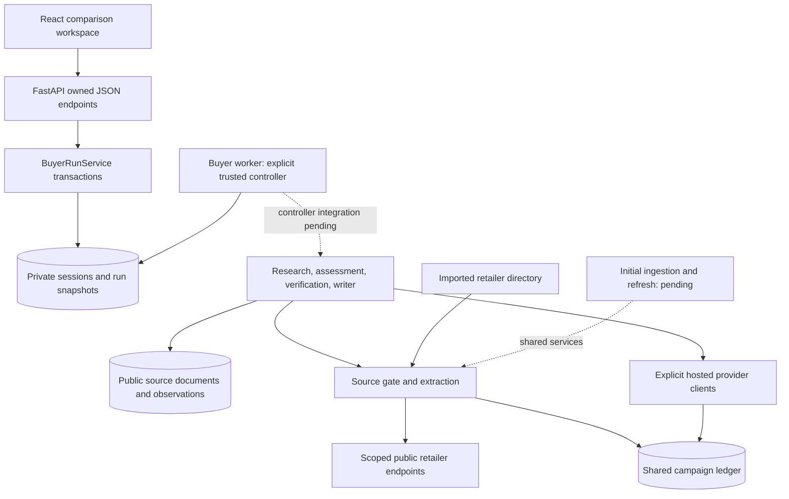

# Architecture, API and reproducibility report

**23 November planning update.** The provider descriptions below are a dated implementation checkpoint. See the [approved design](domestic-search-design.md) for the OpenRouter-only model gateway and the [first buyer flow](live-flow.md) for subsequent integration.

Implementation checkpoint: **17 November 2026**. This report describes the code
through the PC and Parts implementation in [PR #126](https://github.com/han33-dotcom/TechScout/pull/126),
whose implementation commit is `87b08ae23561a57cee12431616561c1b1bdeac0b`.
It is the incremental report deliverable for
[#83](https://github.com/han33-dotcom/TechScout/issues/83), not the final release
evaluation. The [delivery plan](full-product-plan.md) describes the target product;
the status table below identifies what this checkout actually provides.

## Product scope and implementation status

TechScout compares electronics for buyers in Lebanon. The v2 contracts cover
phones, laptops, tablets, monitors, headphones and earbuds, with exact-model,
product-link and needs-based requests. Lebanon and new condition are defaults.
Foreign purchase offers and other conditions require explicit buyer choices.
Checkout, payments, seller messaging and retailer-account creation are outside
the application. A foreign specification source is not a foreign purchase offer.

| Area | Implemented at this checkpoint | Remaining boundary |
| --- | --- | --- |
| Buyer workspace | React request/filter, progress, clarification, comparison, refinement and history UI; typed FastAPI client | Complete live browser-to-result flow remains #75/#76 |
| Owned API/worker | Durable sessions/runs, polling, cancellation, revisions, worker claims and guarded publication | Needs a trusted shopping controller; otherwise runs remain queued |
| Evidence and research | Versioned public corpus, structured/full-text/vector retrieval, freshness, bounded research workers | Full orchestrator and evidence critique remain #68/#69; tablet identity #43 is still pending |
| Retailer acquisition | Legacy readers, bounded Class/Mojitech/Beytech catalog helpers, shared extraction and PC and Parts fixture profile | Coverage is per source/category/field, with documented live gaps; #54 does not activate PC and Parts |
| Cost and verification | Decimal contracts, domestic assessment, final-verification and explanation modules | International retrieval, quotes and landed-cost integration remain #61–#63 |
| Public collection | Directory import, corpus persistence, accounting and worker process foundation | Initial ingestion #87, scheduled refresh #88 and automatic onboarding #99 are not implemented |
| Providers | Direct OpenAI adapter and optional explicit Tavily/Firecrawl/embedding clients | Account access/live quality unverified; optional OpenRouter #89 is not integrated here |
| Evaluation | Offline regression fixtures and CI | Frozen dataset, equivalent baselines, measured comparisons and user study remain #78–#82 |

Passing parser or API tests demonstrates those contracts, not a working live
shopping service, real coverage across five categories, or superiority to a
baseline. The older v1 CLI and its phone-focused records coexist with the v2
workspace. Neither automatically becomes the missing full-product controller.

## Process and module boundaries

The application is a modular Python backend with a separate React frontend. API
and worker processes share Python modules and durable database state. Ordinary
role calls are function calls, not internal HTTP services. The checked-in Compose
stack runs PostgreSQL, a one-shot migration service, the API and an ingestion
**heartbeat** process. The heartbeat checks database/evidence-volume availability;
it does not claim or execute collection jobs. A buyer worker is a separate explicit
entry point and is not started by that Compose worker service.



| Responsibility | Code and contract |
| --- | --- |
| HTTP admission and ownership | `app/buyer_api.py`, `app/buyer_runs.py`; handlers stay thin over service transactions |
| Buyer execution | `app/run_worker.py`; trusted `module:function`, leased `RunContext`, guarded publication |
| v2 contracts and role interfaces | `app/contracts_v2.py`, `app/contract_interfaces.py`; request/run revisions and typed evidence |
| Research | `app/research_workers.py`, `app/research.py`; stored evidence first, bounded scoped gaps and discovery |
| Deterministic decisions | `app/identity.py`, `app/assessment.py`, `app/costs.py`, `app/verification.py` |
| Grounded explanation | `app/writer.py`; evidence-backed claims and deterministic fallback |
| Acquisition | `app/sources.py`, `app/source_capabilities.py`, `app/page_extraction.py`, `app/adapters/` |
| Durable public knowledge | `app/corpus.py`, `app/freshness.py`, `app/retrieval.py`, `app/embeddings.py`, `app/directory.py` |
| Spend/workload control | `app/accounting.py`; cross-process reservations, source leases and campaign limits |

This boundary keeps the small project deployable without a distributed broker or
per-agent services. Database locks serialize short claims/state transitions and
are released before network work. The ledger currently uses a serialized campaign
row: simple to audit at the configured scale, but a potential contention point at
larger volume. Split services or migrate the ledger to indexed attempt tables only
after measuring workload and contention. A graph database is not required by the
current exact-field, relational, text and vector queries.

## Request, evidence and decision flow

1. The browser constructs a v2 `ShoppingRequest` and exposes its interpreted
   constraints for editing. Approximate budgets remain preferences; explicit
   maxima are hard limits. Browser form interpretation is not proof of the future
   needs-based orchestrator's reasoning quality.
2. The API persists the owned request and queues a run. It returns immediately;
   polling retrieves durable state rather than holding an HTTP request open for
   the execution budget. A configured worker claims the run and receives its
   remaining active time and cancellation checks.
3. Research modules retrieve scoped existing evidence and consult the directory.
   Exact product, variant, route, branch and field filters constrain retrieval
   before similarity ranking. An LLM may order permitted work; it cannot admit a
   source, invent an action, relax buyer constraints or allocate extra budget.
4. Public reads pass the registry, network/source gate and ledger. Extraction
   emits typed observations and immutable provenance. Shared HTML/JSON-LD parsing,
   dedicated retailer readers and explicitly enabled Firecrawl reuse this path.
   Page text is untrusted data and cannot invoke tools.
5. Deterministic matching, eligibility and cost checks assess the resulting facts.
   Prices use Decimal. Missing mandatory charges stay unknown, conflicting
   evidence stays conflicting, and a delivery estimate is not a guarantee.
6. Provisional stored candidates may be published with original observation times.
   Main recommendations require current-run price/stock checks and complete
   eligibility/cost evidence. Only up to three eligible recommendations are
   displayed; fewer or none is a valid result.
7. A refinement creates a new request revision/run. Old results remain separate
   from the current workspace; late callbacks cannot mutate cancelled or superseded
   results. Explanation modules cannot fill gaps with plausible prose.

Steps 3–7 describe the implemented module contracts and intended integration;
their complete orchestration is still pending. Offline worker/API tests exercise
publication with controlled controllers, not a hidden production controller.

## Storage, provenance and freshness

PostgreSQL is the supported database; SQLite provides an offline fixture path.
Alembic revisions `0001`–`0008` add the original records, pgvector, public corpus,
retirements, embedding usage, retailer directory, shared accounting and owned
buyer sessions/runs. Contract JSON accompanies queryable relational columns.
Private buyer requests and history are not indexed into the public corpus.

Public resources retain source URL, exact product/variant/branch/route scope,
original observation time, raw-response SHA-256, field excerpt/locator and
corpus/extraction/chunk/index versions. Snapshots live under `EVIDENCE_DIR` with
restricted permissions, are checked against their hashes, and are not served as
public HTTP files. Keep database and evidence-volume backups together.

PostgreSQL full-text search uses the GIN `simple` index; pgvector uses cosine
distance. Reciprocal-rank fusion combines at most 200 keyword and 200 vector
candidates into at most 20 hits after scope/version filtering. SQLite's bounded
text/vector fallback verifies mechanics, not production recall. Embedding calls
are explicit, versioned and metered; reindexing does not refresh source facts.

Default reuse ages are 30 days for specifications and 7 days for general policies,
with earlier explicit expiry and conflict/retirement checks. Item quotes require
their exact route/package context and expiry. Price and stock still need current
run verification. HTTP 304, unchanged pages and new extraction/index versions do
not reset original observation ages. See [evidence services](evidence-services.md).

## Owned API and UI state

`GET /api/session` creates/reuses a 24-hour session and returns a CSRF token. The
cookie is HttpOnly and SameSite=Strict; only its hash is persisted. Secure cookies
are the backend default. Local HTTP needs `TECHSCOUT_COOKIE_SECURE=0`; Compose
already supplies that local default. HTTPS deployments use `1` and trusted proxy
scheme/host forwarding. All mutations require the exact `Origin` and
`X-CSRF-Token`. Cross-session guessed run IDs return 404, and API responses are
`Cache-Control: no-store`.

| Endpoint | Behavior |
| --- | --- |
| `POST /api/runs` | v2 request with revision 1; returns 202 `RunSnapshot` |
| `GET /api/runs/{run_id}` | Owner's `ComparisonWorkspace`, including current and previous revisions |
| `POST /api/runs/{run_id}/clarify` | Complete `run`, `clarification_id`, bounded `answer`; 202 resumed snapshot |
| `POST /api/runs/{run_id}/cancel` | Complete `run`; terminal cancellation is idempotent |
| `POST /api/runs/{run_id}/refine` | Complete `run` plus next-revision `request`; 202 workspace |
| `GET /api/history?limit=20` | Latest owned search revisions, maximum 20 |
| `GET /api/history/{run_id}` | Historical workspace; reopening does not resume/reverify |
| `POST /api/history/{run_id}/delete` | Delete all owned request revisions; cancel active work first |
| `GET /api/history/{run_id}/export?include_evidence=true` | Sanitized historical plain-text download |

Error contracts distinguish 401 session expiry, 403 origin/CSRF, 404 unknown or
unowned run, 409 stale revision/active deletion, 413 payload over 64 KiB, 422
invalid input and 429 admission capacity. Default limits are one active run per
session, 20 globally and two running controllers. Worker leases last 15 seconds;
expired work becomes partial rather than being automatically replayed. The
120-second active allowance spans clarification resumes; queued/human wait time
does not count or replenish it. Threads cannot forcibly cancel an already-sent
remote request, but late publication is rejected.

`frontend/src/useWorkspace.ts` owns the selected workspace, mutation lock and
poll generation. Superseded polls are aborted, responses are revision-checked,
and ambiguous mutations are not automatically retried. History is visibly
historical. Export omits private identifiers, request text, destination details,
credentials and raw excerpts. Session expiry denies access immediately; physical
cleanup is opportunistic, not a scheduled deletion SLA. Backup retention is an
operator responsibility. See [history](buyer-history.md).

The frontend is **React + TypeScript + Vite**, with generated OpenAPI types and a
same-origin client. It supersedes the earlier template-page proposal; there is
no Streamlit application. Development Vite proxies `/api`, `/health` and `/sources`
to FastAPI. Production serves compiled assets from FastAPI; the SPA fallback must
not turn missing API/evidence/asset paths into successful HTML responses.

### Executable local API example

With a migrated local API listening on port 8000 and local HTTP cookies enabled,
run this in PowerShell. It queues, polls and cancels a synthetic request. It makes
no provider call by itself; do not run it against a worker configured for live
shopping if you intend an offline lifecycle demonstration.

```powershell
$base = 'http://127.0.0.1:8000'
$session = Invoke-RestMethod "$base/api/session" -SessionVariable buyerSession
$headers = @{ Origin = $base; 'X-CSRF-Token' = $session.csrf_token }
$request = @{
  schema_version = 2; request_id = [guid]::NewGuid().ToString(); revision = 1
  intent = @{ kind = 'exact_model'; model = 'Synthetic Laptop' }
  requirements = @{ category = 'laptop'; min_ram_gb = 16; min_storage_gb = 512 }
  budget = @{ maximum = @{ amount = '1200.00'; currency = 'USD' } }
  fulfillment = @{ mode = 'delivery'; destination = @{ country = 'LB'; city = 'Beirut' } }
}
$run = Invoke-RestMethod "$base/api/runs" -Method Post -WebSession $buyerSession `
  -Headers $headers -ContentType 'application/json' -Body ($request | ConvertTo-Json -Depth 12)
$workspace = Invoke-RestMethod "$base/api/runs/$($run.run.run_id)" -WebSession $buyerSession
$workspace.current.status
Invoke-RestMethod "$base/api/runs/$($run.run.run_id)/cancel" -Method Post `
  -WebSession $buyerSession -Headers $headers -ContentType 'application/json' `
  -Body (@{ run = $workspace.current.run } | ConvertTo-Json -Depth 12)
```

Without a configured controller the poll returns `queued`, then cancellation
returns `cancelled`. `/openapi.json` is the authoritative response schema. Use the
latest full run reference for cancellation/clarification/refinement; a stale
reference is an error, not permission to overwrite newer work.

## Providers and shared accounting

The configured primary hosted model is the direct OpenAI adapter behind
`ModelProvider.generate`; the checkout pins its model, effort, prompt version,
token/time ceilings and Decimal price table in `config/evaluation.json`. These
are recorded configuration values, not a claim of current account access or
freshly measured provider prices. Production must verify supported models,
pricing and account access before paid execution. Locally validated structured
outputs do not grant evidence or tool privileges.

OpenRouter is an optional future adapter (#89), not a prerequisite or enabled
fallback. It must use the same interface with explicit provider/model allowlists,
capability checks, requested/actual attribution, bounded fees and separately
reserved attempts. No silent model substitution or cheapest-route selection is
allowed. The legacy Anthropic implementation remains for explicit historical
work; `--planner model` currently selects the OpenAI bridge. The CLI's default is
the rule baseline, not a paid model. Provider/account data policies and retention
settings require deployment verification; the application does not claim to
configure or enforce provider-side retention.

Keys remain backend-only (`OPENAI_API_KEY`, `TAVILY_API_KEY`, `FIRECRAWL_API_KEY`),
never in `VITE_` variables, browser assets, exports or version control. Tavily
returns discovery leads, not admitted sources. Firecrawl is an explicitly enabled
fallback under source and budget checks, not a bypass for authentication or unsafe
targets. Missing credentials or unpriced models fail explicitly.

Every API/worker/developer client must use the same centrally provisioned
`TECHSCOUT_ACCOUNTING_URL` and project identity; this is separate from its local
`DATABASE_URL`. There is no operational local-ledger fallback. As recorded in
[#60](https://github.com/han33-dotcom/TechScout/issues/60), local PostgreSQL access
has been restored but no existing TechScout ledger was found there. Shared
provisioning and reconciliation remain outstanding at this checkpoint. The
checked-in Compose stack does not pass the accounting variables or provision that
shared service; a deployment must explicitly wire them before live work.

Reservations precede source/provider dispatch, retries and fallback. Unknown
usage retains its full allowance; late/crashed owners cannot refund it. Database
recovery releases expired concurrency ownership, never resets consumed money.
The total campaign is capped at $500. Initial collection has shared all-market
limits of 3,000 attempts, 200 paid calls, three worker-hours and $50; international
work also fits its nested 1,000/60/one-hour/$15 envelope. Maintenance has shared
UTC-day limits of 300/30/30 minutes/$3, with an international subset of
100/10/15 minutes/$1. Buyer defaults are 40 calls, $1 and 120 seconds, including
the final-verification reserve. These are ceilings, not measured consumption or
authorization to spend automatically. See [accounting](shared-accounting.md).

## Directory, collection and corpus reproduction

After migrations, `python -m app.directory import-seeds` imports the checked-in
Lebanese audit and international planning targets without network calls. Reimport
is idempotent; older/equal-time conflicting updates cannot replace newer records.
A discovered retailer, tested category and qualifying offer are distinct states.
The directory cannot activate an endpoint or turn country coverage into delivery
eligibility. See [directory](retailer-directory.md).

There is **no initial-collection command or refresh scheduler yet**. The ingestion
heartbeat process is not evidence that jobs run. #87 must supply manifest-driven
collection/checkpoints; #88 must supply incremental scheduling/manual triggers,
pause/resume, changed-content processing and lease recovery; #99 must supply
automatic technical onboarding. Do not invent a CLI or claim these scenarios have
been demonstrated. The committed international manifest is a planning/audit
artifact, not a collected corpus or ledger transaction.

The required future reproducibility manifest records selected source/capability
versions, markets/categories, exact URLs and variants, page/attempt/paid-call/time/
spend ceilings, job/campaign IDs, corpus/extraction/chunk/embedding/index versions,
timestamps, checkpoints, usage and gaps. Reruns must preserve source observation
ages, reuse unchanged documents/embeddings, and retain partial coverage without
resetting aggregate allowances. Pause/resume must retain the same job identity;
scheduled and manual jobs share daily/source limits. Public corpus artifacts must
exclude private buyer requests and preferences. None of this is enabled merely by
starting Compose, importing the directory or toggling international offers.

Current reproducible corpus demonstrations are offline fixtures:

```sh
python -m unittest discover -s tests -p test_corpus.py -v
python -m unittest discover -s tests -p test_retrieval.py -v
python -m unittest discover -s tests -p test_research_workers.py -v
python -m unittest discover -s tests -p test_pcandparts.py -v
```

They establish persistence/filtering/reuse mechanics. Live coverage, latency,
recall, embedding quality and complete delivered offers require dated measurements
after provisioning. Finalist price/stock, item eligibility and expiring route
quotes remain runtime checks even after a public corpus exists.

## Setup, versions and validation

Use a fresh checkout and Python 3.11. Follow [collaborator setup](collaborator-setup.md)
and the [README](../README.md) for complete host/Compose and paired recovery commands.
For an offline local database, leave provider keys absent and run from the root:

```powershell
py -3.11 -m venv .venv
.\.venv\Scripts\Activate.ps1
python -m pip install -r requirements.txt
python -m alembic upgrade head
python -m app.storage load-fixtures
python -m app.directory import-seeds
npm --prefix frontend ci
npm --prefix frontend run build
$env:TECHSCOUT_COOKIE_SECURE = '0'
python -m uvicorn app.main:app --host 127.0.0.1 --port 8000
```

Unset `DATABASE_URL` uses a local SQLite file for this lifecycle demonstration.
Export a PostgreSQL URL for supported deployment; host commands do not load `.env`
automatically. Compose does load its environment file. The API and buyer worker
must share their application database. The worker command is
`python -m app.run_worker --controller trusted.module:function`; the callable is
deployment-supplied, never request-supplied. No production controller is supplied
by this report. For development run Vite in another terminal; for production
restart FastAPI after building assets so it mounts the compiled SPA.

| Component | Pinned/configured checkpoint |
| --- | --- |
| Backend runtime | Python 3.11; Docker `python:3.11-slim` tag is not digest-pinned |
| Python dependencies | `requirements.txt`: Pydantic 2.13.5, FastAPI 0.143.0, SQLAlchemy 2.1.4, Alembic 1.20.0, psycopg 3.3.6, pgvector 0.5.1 |
| Database | PostgreSQL 17 / pgvector 0.8.2 image, digest pinned in Compose and CI |
| Frontend | React 19.2.9, TypeScript 5.9.3, Vite 7.3.8; resolved tree in `frontend/package-lock.json` |
| Node | Docker 24.14.1 digest-pinned; CI Node 22; package minimum 22.12 |
| Model configuration | `config/evaluation.json`: direct OpenAI `gpt-6.1-sol`, low effort, `roles-v1`; pricing date recorded there |
| Embeddings | Explicit `text-embedding-3-small`, 1536 dimensions, configured price and index version |

Record the actual commit, interpreter/package versions, image digests, configuration
hashes and corpus/index versions with each evaluation. Pinned package lists do not
pin the external provider implementation or retailer pages. Model/routing changes
must be labeled separately from the main evaluation. Offline synthetic assertions
are not held-out metrics, source availability measurements or provider bills.

Required PR checks are `test` and `build`. CI runs frontend interactions/typecheck/
production build, the Python suite on SQLite and PostgreSQL, PostgreSQL migrations/
fixture loading, and a disposable Docker build/restart/backup/restore rehearsal.
Local equivalents are:

```sh
python -m unittest discover -s tests -v
npm --prefix frontend test
npm --prefix frontend run build
python scripts/check_local_stack.py
```

`TEST_DATABASE_URL` must point only to a disposable database: the tests reset its
schema. The Docker rehearsal creates disposable projects; it does not validate
live retailer/provider access. Record exact results and unavailable checks in the
PR. No live network call is needed for ordinary fixtures.

At this checkpoint, PR #126 passed all **756 local Python tests** and both
[required CI checks](https://github.com/han33-dotcom/TechScout/actions/runs/44127999585)
on implementation commit `87b08ae`. The report's PowerShell API example was
executed against a localhost-only API with a disposable migrated SQLite database:
session creation, queued creation/polling and persisted cancellation succeeded.
No buyer worker, retailer calls or paid provider calls were involved. Local
Markdown links were checked. These results validate the described checkpoint;
they are not measurements of full-product recommendation quality or live coverage.

## Release handoff and remaining evidence

This incremental report can be maintained while interfaces settle. Final release
synchronization remains part of #85: check out the release commit, update this
checkpoint/status matrix and API examples against that commit, regenerate OpenAPI
types if needed, capture actual validation/evaluation artifacts, and record all
source/model/config/corpus hashes in the release report. A final release commit
does not exist at this checkpoint, so none is asserted here.

The release report must distinguish implemented modules, demonstrated integrated
flows, measured evaluation results and unresolved limitations. In particular it
must revisit tablet identity/orchestration, international routes, initial and
background collection, shared ledger deployment, provider account access and
retailer coverage. Current blockers and source failures remain linked from the
[board](https://github.com/users/han33-dotcom/projects/2), the
[source audit](retailer-audit-2026-11-16.md), the
[international audit](international-source-audit.md) and
[PC and Parts evidence](pcandparts.md). No live success is inferred from a merged PR.
