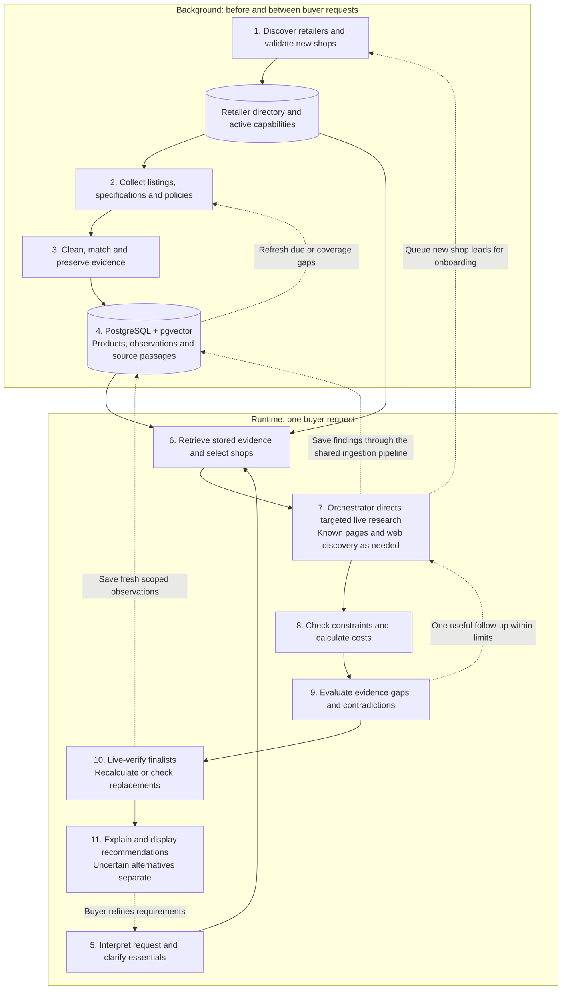
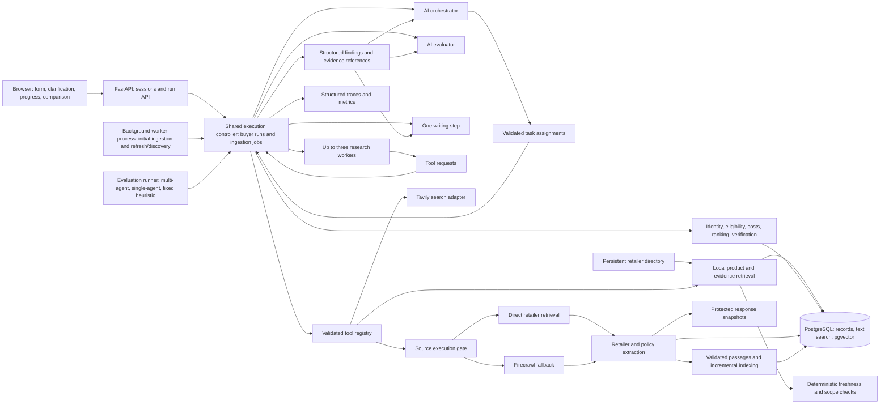

# TechScout full product and submission plan

Approved delivery plan. Implementation status updated 16 November 2026.

Build one Path A submission that compares electronics offers in Lebanon and international markets, explains how they meet the buyer's needs, and distinguishes verified payable totals from incomplete or estimated landed costs. The submission deadline is Saturday, December 5, 2026. Section 9 lists the target checkpoints leading to submission.

The [GitHub backlog](https://github.com/han33-dotcom/TechScout/issues/36) contains the 53 delivery tasks, their prerequisites and the crosswalk from the earlier MVP issues. Use GitHub issue state and assignees to see live progress.

The application uses the merged foundation and shopping stack described in section 7. The [v1 specification](mvp-spec.md) continues to govern existing records until the contract migration in [task #41](https://github.com/han33-dotcom/TechScout/issues/41).

## 1. Product and user experience

The user is a buyer in Lebanon who currently opens retailer pages, reconciles inconsistent specifications and prices, and manually checks whether a purchase is actually usable and affordable. TechScout should save that work and expose the facts that could change the decision.

Both entry paths are confirmed core submission features and share the same comparison engine:

- **Find this product:** an exact model, product name, or retailer link, followed by variant and purchase constraints.
- **Help me choose:** a category, use case, budget, and required specifications. The agent proposes a small set of concrete models, explains the tradeoffs with evidence, and compares offers for those models. It asks for clarification only when a missing answer materially changes the search.

Confirmed interaction: automatically investigate suitable models and return them with actual retailer offers. Product selection and offer discovery inform each other, so observed availability and prices can change the shortlist. There is no mandatory model-selection pause before retailer search. Buyers can inspect product tradeoffs, compare sellers for each model, and steer or refine the search.

Confirmed interface: a search-and-comparison workspace with built-in conversation. A prominent natural-language input accepts exact products or shopping needs; editable filters show the interpreted requirements. Product cards, seller offers, prices, specifications, and evidence stay visible for comparison. Short clarification questions and a follow-up input support conversational refinement, while filters offer direct control. Changes update the comparison through the run/refinement flow. Show meaningful progress and cancellation controls during searches. The main screen centers on the request and comparison rather than a scrolling message history.

Confirmed market default: search Lebanon only unless the buyer explicitly opts into international offers. Provide a prominent Include international offers option; when enabled, retain domestic results and add supported foreign markets. Show the chosen scope in the editable request summary and allow it to be changed through refinement. Do not silently expand the search internationally when domestic results are scarce.

Confirmed international fulfillment scope: support both direct delivery to Lebanon and package forwarding through an overseas address. Label the route on each offer. Keep estimated landed costs and incomplete totals separate from verified payable totals; enabling international offers does not imply that a particular retailer or forwarder supports the buyer's item or destination.

### Confirmed buyer experience

The buyer keeps the comparison visible in the main workspace, with conversation for clarification/refinement and editable filters for direct control. The following walkthrough is confirmed for implementation; its laptop query is an illustrative scenario, not a real recommendation.

1. **Enter a request:** one prominent input accepts needs, an exact model or a retailer product link, with category shortcuts. Lebanon and new condition are defaults; Include international offers starts off.
2. **Inspect interpreted requirements:** show editable category/model, budget, use case, destination/fulfillment, condition, market scope and relevant preferences. Preserve the difference between an approximate budget and a hard maximum; do not silently tighten or relax constraints. Ask only a material clarification, such as which engineering applications must run. There is no mandatory confirmation step before every search or model-selection pause.
3. **Follow useful progress:** show phases such as finding suitable models, comparing sellers and verifying final prices, with cancellation and revision controls. Display available stored candidates promptly with checking labels and original observation times; they are not verified main recommendations. Do not invent progress percentages or imply every shop has been checked.
4. **Compare recommendations:** display up to three distinct-model recommendations for needs-based requests, with exact configuration, evidence-backed suitability, main tradeoff, selected seller, verified total, route/delivery facts, check time and retailer link. Group additional qualifying sellers underneath each model. Provide side-by-side comparison and separate unresolved alternatives explaining missing facts. Show fewer than three, or no qualifying recommendation, honestly when evidence is insufficient.
5. **Refine in place:** accept filters or conversation such as prioritizing battery life or explicitly enabling international offers. A new request revision reuses relevant evidence, recomputes affected decisions and live-checks finalists. Earlier results retain their previous requirements/version and cannot appear current while replacement results are pending.
6. **Open the retailer:** buying happens on the selected retailer's site. No checkout, payment handling, seller messaging or retailer-account creation is added. Exact-product requests use the same workspace and focus on configuration and seller comparison without requiring the buyer to choose among alternative models first.

Acceptance walkthroughs include an approximate-budget engineering-laptop request delivered to Beirut with a battery-life preference, an exact-phone/configuration or product-link request, a material clarification, a refinement that changes priorities or market scope, and insufficient/uncertain results. Buyers should be able to explain suitability versus seller choice, provisional versus verified results and what costs remain unknown. The experience and React + TypeScript + Vite implementation are confirmed; see section 3.

### Submission feature set

| Feature | User-visible behavior | Completion evidence |
|---|---|---|
| Broad electronics | Category-aware search for phones, laptops, tablets, monitors, and headphones/earbuds | Real retrieval and identity fixtures across the category set; unsupported source/category combinations explicitly identified |
| Exact and needs-based requests | Accept a known device or translate a use case into editable requirements and candidate models | Demonstrate both paths without silently changing hard constraints |
| Domestic and international search | Lebanon by default; explicitly include international offers, with optional selection of supported foreign markets | Domestic results remain available when international search is enabled; source/market coverage is shown |
| Direct delivery and package forwarding | Identify how an international offer reaches Lebanon and show the route's known charges and gaps | Demonstrate both route types; estimates and incomplete totals remain outside verified primary ranking |
| Variant and condition matching | Preserve storage, memory, color, region, connectivity, and new/refurbished/used condition where relevant | Wrong variants and unverified condition do not pass required constraints |
| Purchase feasibility | Compare pickup or delivery, cash/card, warranty, stock scope, and deadlines | Exclusions and missing evidence are visible at field level |
| Honest cost comparison | Show device price, taxes, shipping, payment/FX fees, and applicable import costs | Included charges are not duplicated; missing charges are not zero |
| Coordinated AI agents | An orchestrator assigns focused research, an evaluator checks findings, and a writing step explains checked results | Trace demonstrates useful delegation and recovery; evaluate quality, latency, and cost against single-agent and fixed-heuristic configurations |
| Upfront ingestion and retailer directory | Populate products, source passages and assessed retailer metadata before buyer requests; refresh incrementally | A fresh buyer session retrieves a versioned pre-ingested corpus; source/category gaps and collection costs are recorded |
| Persistent evidence reuse and agentic RAG | Consult stored product facts and relevant source passages, investigate gaps, and refresh outdated evidence | Compare first-time and repeat searches for validity, coverage, latency, and total cost; every reused claim retains its provenance |
| Live verification | Recheck finalists during the current run and replace changed/unavailable offers | Price/stock drift scenario removes or reranks an affected finalist |
| Useful results | Up to three main recommendations, uncertain alternatives in a separate section, expandable additional qualifying results, side-by-side comparison, cost breakdown, evidence, and retailer links | Buyer can explain why an offer qualifies and what remains uncertain; incomplete evidence never fills a main recommendation slot |
| Refinement | Change a constraint, confirm alternatives, retry a failed source, or cancel | Revised constraints create a new request revision and invalidate affected decisions |
| Session history | Reopen recent searches in the same session and export a shareable report without private session data | Ownership checks and expiry work; an old result is visibly historical until rechecked |
| Reliability and observability | Clear partial/failure states, source coverage, freshness, runtime, and operator traces | Interrupted, failed, and budget-limited runs preserve truthful results |

The five confirmed submission categories are phones, laptops, tablets, monitors, and headphones/earbuds. Prioritize deeper source coverage, specification matching, and needs-based recommendation evidence for phones and laptops. The other three categories still require real retrieval and meaningful matching for both entry paths. PC components, TVs, and gaming consoles are outside the agreed submission category set. Day 1 establishes a source-by-category inventory so breadth is demonstrated rather than merely exposed in a dropdown. Lebanese coverage strategy: maintain a broad discovery inventory and deeply audit roughly 10-15 priority retailers, including established retailers and smaller local shops with usable public catalogs. This is a deep-validation sample, not a cap on discovery or a commitment to that many custom integrations; section 5.2 defines how wider coverage is evaluated. Reuse the three existing source integrations and select additional dedicated adapters by category coverage, evidence quality, and retrieval reliability. Prioritize broader Lebanese coverage over adding further international markets. International coverage should include at least two usable sources. The initial US/UAE targets are Microless, B&H and Amazon US, with MyUS first and Stackry backup for forwarding; technical checks must establish usable items/routes or document replacement needs.

New is the default condition. Refurbished and used offers require explicit buyer selection and evidence; unknown grading, warranty, or seller condition stays unresolved. The system completes comparison, not checkout. Payments, seller messaging, retailer-account creation, long-term price alerts, and marketplace order management are not part of this product's submission scope.

### Competitive lessons incorporated (15 November 2026)

TechScout's intended advantage is a more dependable purchase decision: explain product suitability, exact configuration, current retailer-reported availability, purchase terms, and complete or explicitly uncertain cost. Broad aggregation, AI search, matching and price history already exist locally; neither AI nor retailer count alone establishes novelty or superiority. LebTech and One Souq are required local evaluation baselines (section 10). This is a design hypothesis to test, not a demonstrated advantage.

- Explain why a model fits separately from which seller offer is preferable. Show compact attribute differences for confirmed equivalents, different configurations and unresolved matches. Preserve phone SIM/region/activation differences and laptop CPU/GPU/RAM/storage/display differences; warranty and condition remain explicit offer terms.
- Present item price, tax treatment, delivery/pickup, route and known/estimated/missing costs beside each offer. Show observation times for individual price, stock and policy claims, rather than a single generic updated-today badge.
- Return available stored candidates promptly while research continues, labelled provisional and pending verification with original timestamps. They cannot occupy verified main-recommendation slots until current-run checks pass. Preserve request revision and cancellation rules; 120 seconds is a ceiling, not a mandatory delay.
- Exercise representative English, Arabic and Arabizi requests and expose the interpreted requirements for correction. Report measured language limitations; this does not add a fully translated interface commitment.
- Measure useful multi-seller comparisons and successful requests alongside accuracy, uncertainty and latency. A known retailer, a retrieved page and a qualifying offer are different coverage states.
- Retain observations that could support future price history, but do not add a history-chart, alert, marketplace, social-review, retailer-dashboard or native-app deliverable to this submission.

Research basis: [LebTech method](https://lebtechlb.com/how-we-compare-prices), [One Souq overview](https://onesouqlb.com/about), [One Souq example with differing SIM/warranty descriptions](https://onesouqlb.com/product/1687-apple-iphone-17-pro-max-256gb), and [SoukCompare's multi-shop coverage metric](https://soukcompare.com/electronics). Public pages were inspected on November 15; claims of coverage are self-reported and assistants were not benchmarked during this research. These observations motivate the tests, not a claim that competitors consistently fail them.

## 2. High-level data flow

Two connected flows share the same source gate, extraction, provenance, validation, indexing and budget infrastructure. Upfront/background ingestion builds reusable public knowledge; runtime research answers a buyer's request. Background collection cannot produce buyer-specific eligibility or current-run verification.

1. **Discover and assess retailers.** Seed a broad persistent directory with canonical seller/domain, market/category/brand coverage, catalog/policy routes, evidence links and dated retrieval findings. Deep-audit roughly 10-15 priority shops without capping discovery. Automatically probe eligible leads and activate only capabilities that pass technical validation (section 5.3). Use selection priority to allocate research effort. Offers rank on buyer fit and verified purchase facts.
2. **Collect ahead of requests and refresh between them.** Bounded jobs discover URLs and retrieve relevant retailer listings/policies, manufacturer specifications and selected review/measurement evidence across five categories. Support initial ingestion and configurable incremental refresh/discovery. Tag international records so only opted-in buyer requests use them.
3. **Clean and normalize without losing evidence.** Preserve permitted source snapshots/excerpts and timestamps before removing boilerplate. Extract typed fields, match exact variants, deduplicate and retain conflicts/unknowns. Chunk relevant passages and embed only new/changed content. Runtime findings use this same pipeline.
4. **Persist a corpus before the first buyer search.** Store exact attributes, monetary observations and relationships in structured PostgreSQL; use full-text/pgvector for relevant passages. Retain original source versions and observation dates. The database is not merely a cache of earlier queries; price/stock observations remain historical until current-run verification.
5. **Interpret input.** Accept an exact model/link or needs-based request, separate hard constraints/preferences, expose editable requirements and clarify only essential gaps. Create an owned request revision/run with Lebanon and new condition as defaults.
6. **Retrieve evidence and select shops.** Consult the pre-ingested corpus, retailer directory and earlier runtime evidence. Apply category, variant, destination, market, permission and freshness filters. Stored facts support candidate selection, not proof of current purchase feasibility.
7. **Investigate gaps.** The AI orchestrator directs up to three focused workers, using fewer when evidence suffices. Fetch known URLs and search for missing models, evidence or stores. Queue unconfigured retailer leads for the background onboarding worker. Investigate models and offers together, normalize findings and save reusable public evidence.
8. **Compute eligibility and cost.** Code checks exact configurations, hard constraints and purchase terms, calculates charges with Decimal and preserves exclusions/unresolved alternatives. Unknown required charges never become zero.
9. **Evaluate evidence.** The evaluator flags gaps, contradictions and unsupported claims. At most one useful targeted follow-up round and reevaluation share the original budget; agents cannot override deterministic decisions or buyer requirements.
10. **Live-verify finalists.** Reserve resources to recheck selected-variant prices, retailer-reported stock, required facts and costs during the current run. Recompute changed offers and check replacements within reserve. Failed refreshes remain historical/unresolved. Persist observations without treating a background check as current-run verification.
11. **Explain and display.** One tool-free writing step explains validated records with factual/citation validation and a deterministic fallback. Show up to three verified recommendations (fewer or none if needed), separate uncertainty, model-fit/seller differences, component costs, timestamps, sources and checked coverage. Early candidates stay explicitly provisional. Refinement creates a new request revision.

Buyer actions link request revision/run/source/offer/evidence IDs; background actions carry ingestion job/manifest/corpus IDs. The shared software execution controller enforces global spend, source workloads, cancellation and traces for both. The 120-second limit applies to buyer active execution; ingestion jobs have their own bounded manifests within the shared $500 ledger. Old eligibility decisions never become current through reuse.

## 3. Architecture and responsibility boundaries

Confirmed AI architecture: one AI orchestrator, up to three concurrent research workers, an AI evaluator, and one bounded final writing step. These are distinct responsibilities with focused contexts and tool permissions; they can use the same underlying model. Simple requests use fewer researchers. Workers cannot recursively spawn agents.

Confirmed backend architecture: retain the Python/FastAPI foundation as a modular monolith with one backend codebase and explicit modules for the retailer directory, ingestion, retrieval, agent orchestration, matching, eligibility/costs, verification and evaluation. Run the API and background ingestion worker as separate processes from that codebase, using the same versioned contracts, evidence pipeline and PostgreSQL database. Multiple AI roles are bounded concurrent responsibilities, not separately deployed microservices. TechScout's Python execution controller coordinates the agent roles for the December 5 submission.

Confirmed storage: PostgreSQL provides structured records, foreign keys/relationship tables, full-text search and pgvector semantic retrieval. No separate graph database or vector database service is included. Persistent evidence reuse and agentic RAG use these same records and passages. This architecture is selected for shared evidence consistency, transactionally enforced budgets, clear module boundaries and operational simplicity; it is not merely a deadline compromise. Reconsider service extraction or graph storage only for a concrete workload, isolation or relationship-query need supported by measurements.

Local Compose starts the API, background worker and PostgreSQL/pgvector together with persistent evidence storage. Modules call shared typed interfaces inside each process; the worker has explicit entry points and lifecycle controls. Because process memory is not shared, spend reservations, source workloads, job ownership/checkpoints and duplicate-fetch coordination must work across API/worker processes using durable coordination rather than process-local counters alone. Preserve the separately configured project-wide allocation across developer machines. No distributed message broker is required by this design.

Confirmed frontend: React with TypeScript and Vite, communicating with the modular FastAPI backend through typed API contracts. Use reusable components and revision-aware state for requirements, conversation, progress, provisional/verified cards, seller groups, evidence and comparison selection. Server-side eligibility, verification and costs remain authoritative. No Streamlit; this replaces the earlier template-based frontend proposal.

Use Vite for local development and production asset builds. Package the compiled frontend with the application and serve it under the same origin as the API; configure the development proxy and any SPA route fallback without masking API errors. A Node build stage/toolchain is needed, but no persistent Node application server or React SSR service is required. Preserve backend-only credentials, session/CSRF controls, explicit API loading/error states and cancellation/revision handling. Include TypeScript checks, a reproducible lockfile-based frontend build and focused interaction checks in existing CI/build tasks; the frontend remains in the same repository and local Compose deployment.

| Component | Responsibility | Boundary |
|---|---|---|
| Buyer UI and API | Input, clarification, progress, cancellation, results, report export | Session authorization applies to every run and evidence view |
| Execution controller | Buyer-run and ingestion-job state, bounded scheduling, deadlines, atomic reservations, cancellation and recovery | All paid/network work shares this layer and source limits; AI cannot raise budgets |
| Retailer directory | Canonical sellers, domains, categories, retrieval capabilities and evidence-linked policies/technical findings | Discovered does not mean authorized, trustworthy or qualifying; no preferred-seller ranking |
| Ingestion jobs | Initial collection, incremental refresh/discovery, manifests and resumable checkpoints | Shared retrieval/extraction pipeline; separately metered maintenance inside the same project budget |
| AI orchestrator | Interpret intent, partition research, merge findings, and select useful follow-up work | Cannot change hard constraints, authorize sources, override code decisions, or recursively delegate |
| Research workers | Investigate assigned product, offer, or policy questions using registered tools | Return structured evidence and uncertainty; no independent budgets or authority to declare verification |
| AI evaluator | Flag missing requirements, conflicting evidence, and unsupported tradeoffs | Advisory findings; cannot replace deterministic checks or start an unlimited critique loop |
| Writing step | Explain the checked comparison and its limitations | One tool-free model call; facts and citations must match validated records |
| Search/discovery | Query known catalogs and configured search providers | Search leads need retrieval and verification before recommendation |
| Evidence retrieval and freshness | Filter records and retrieve bounded relevant passages; assess applicability, age, expiry, and conflicts | Semantic similarity cannot satisfy exact identity, numeric constraints, or live verification |
| Evidence ingestion and indexing | Save source-linked observations/passages, deduplicate content, and index changed material | Generated answers are not source evidence; index versions and deletion follow the underlying records |
| Source gate | Destination, method, DNS/TLS, redirect, rate, size, timeout, and retry enforcement | All retailer retrieval uses the gate |
| Retailer adapters | Convert source content into observations and evidence | Model-extracted values remain observations until deterministic validation |
| Comparison engine | Identity, deduplication, hard constraints, costs, preference ordering | Same rules used by the agent and fixed baseline |
| Final verifier | Refresh decisive facts and check replacements | No primary recommendation from an unverified cached offer |
| Storage and traces | Validated records, snapshots, actions, measured usage, prompt/model versions | Raw pages and secrets never become unrestricted public output |

The selected initial reasoning model is OpenAI GPT-6.1 Sol (`gpt-6.1-sol`) across the orchestrator, researchers, evaluator, and writing step. Give each role a separate prompt, output schema, and allowed tools; record their versions and the model version used. Validate account access, structured-tool behavior, latency, and cost during integration. An interface allows substitution and deterministic test fakes. Alternative models are optional evaluation configurations, not additional production integrations or prerequisites for implementation.

Run the API and buyer execution worker as separate processes from the shared backend codebase. The [owned buyer API](buyer-api.md) persists session ownership, request revisions, run snapshots, active time and worker leases in the database. It bounds global and per-session admission across processes; excess work is visibly queued or rejected. Concurrent AI research roles remain tasks within the controller, subject to its separate researcher and shared-resource limits. Cancellation/refinement revokes worker writes, and an expired lease records a partial outcome rather than silently retrying stale work. Waiting for clarification pauses active execution time without replenishing it. The worker entry point is ready for controller integration in #67/#68; queued API acceptance alone does not demonstrate a completed shopping flow.

### Agent role interfaces and execution

Implement the orchestrator, each research worker invocation, the evaluator, and the writer as independently callable Python functions. Give each role typed inputs and validated outputs using the shared request, finding, and evidence contracts. Supply model and tool access through explicit interfaces so a role can run against offline fixtures. The orchestrator returns a plan or proposed follow-up. The researchers return findings with evidence references. The evaluator returns gaps and conflicts. The writer returns an explanation grounded in the verified result.

The controller owns workflow transitions, worker scheduling, retry decisions, cancellation, deadlines, spend reservations, and persistence of run state and traces. Use its authorized tool dispatch for external actions and retain the deterministic verification and eligibility rules. Test each role in isolation and exercise cancellation, a worker failure, and a bounded follow-up across roles. [Research workers #67](https://github.com/han33-dotcom/TechScout/issues/67) · [Orchestrator #68](https://github.com/han33-dotcom/TechScout/issues/68) · [Evaluator #69](https://github.com/han33-dotcom/TechScout/issues/69) · [Writer #71](https://github.com/han33-dotcom/TechScout/issues/71)

These interfaces let a future LangGraph adapter call the same roles as nodes if branching or recovery warrants it. Evaluate that option against offline failure fixtures, including how graph checkpoints map to the persisted run record and how replay interacts with paid-call reservations. Keep one authority for run state, tool authorization, and budget enforcement during any migration.

### Persistent evidence reuse and agentic RAG

The evidence store is shared durable product knowledge, distinct from private session history and temporary agent conversations. Retrieve existing evidence, assess its gaps and freshness, acquire only useful additional evidence, then save validated findings. The orchestrator chooses research actions within the existing bounded loop; it cannot override freshness, ownership, provenance, or resource rules. A request may require little new discovery while still requiring live finalist checks.

| Stored information | Retrieval and reuse policy |
|---|---|
| Product/variant identities and specifications | Exact SQL filters and category rules; reuse supported observations until expiry, correction, or conflicting evidence requires review |
| Reviews, benchmarks, and explanatory passages | Full-text and semantic retrieval with exact product/configuration metadata; preserve source, publication date, and tested conditions |
| Retailer URLs and historical offers | Shortlist and revisit known listings directly; historical price/stock is visibly historical and never silently treated as current |
| Shipping, warranty, payment, FX, and import evidence | Scope to destination, route, condition, currency, and applicable dates; refresh decisive facts according to explicit source policy and final verification requirements |
| Previous answers and private requests | Session-owned history only; regenerate decisions for the current request from underlying evidence |

Use structured SQL for model IDs, money, variants, and hard constraints. Combine keyword and semantic passage retrieval for suitability questions, with metadata filtering and bounded result sizes. Use pgvector within PostgreSQL and the selected OpenAI `text-embedding-3-small` embedding model. Validate retrieval with representative English/Arabic requests, exact-model distractors, latency, and cost. Record embedding model/dimensions and chunking versions; do not mix incompatible vectors. Embed new or changed passages and incoming semantic queries, not entire unchanged sites on every request. Citation links resolve to retained source excerpts, not just vectors or generated summaries.

Define configurable freshness policies by fact type and source. Retention duration is not freshness: a retained record can remain useful historically while requiring a refresh for a current decision. Price and stock checks for finalists occur during the current run; bypass provider caches where necessary and inspect the actual selected variant and page state. Expired, superseded, contradictory, or unsupported facts cannot qualify an offer. A failed refresh preserves a labelled historical/unresolved result.

Confirmed freshness defaults (November 15):

| Evidence type | Reuse and refresh policy |
|---|---|
| Product specifications | Reuse for up to 30 days from the supporting observation; investigate sooner if sources conflict or the selected variant differs. |
| General delivery, return, and warranty policies | Reuse for up to 7 days from the supporting observation; recheck sooner when conflicting or necessary to establish purchase eligibility. |
| Prices and stock | Stored observations may identify candidates, but recheck every main recommendation during the current search. |
| Item-specific shipping or forwarding quotes | Reuse only for the same route and package assumptions within the quote's stated validity. An absent validity period does not establish permission to reuse it as a current verified quote. |
| Failed refresh | Preserve the last observation and its timestamp as a historical or uncertain alternative when useful; do not describe it as currently verified. |

The 30-day and 7-day periods are configurable starting defaults, to be adjusted using measured source behavior. They are maximum reuse ages, not guarantees of correctness or a mandatory background polling schedule. Earlier source expiry, superseding evidence, scope mismatch, or a conflict overrides the age allowance. Re-reading or re-indexing stored evidence does not reset its observation timestamp. Fresh stock evidence means the retailer currently reports availability, not a reservation. These freshness defaults do not establish retention/deletion periods or activate background refresh jobs.

### Confirmed upfront ingestion and retailer directory

Populate the database before the first buyer request, then combine background updates with on-demand research. This is a required full-product capability, not dependent on users having already searched for each item. Reuse existing source-registry controls and adapters; the new directory adds persistent discovery/selection metadata rather than replacing technical authorization.

The directory records canonical business/seller identity, aliases/domains, markets, category and brand coverage, catalog/product/policy routes, retrieval method, source-capability references, policy evidence links, last successful checks, missing fields and dated coverage states. Distinguish marketplace sellers and similarly named businesses. Retrieval reliability measures our access/extraction, not seller reputation. Track each lead through discovery, validation, activation, and any later suspension. Only active, validated capabilities are available for normal ingestion and buyer searches.

Initial ingestion uses configured public feeds, catalog endpoints, sitemaps or bounded pagination to discover relevant product URLs. Acquire exact identities/configurations, observed price/stock, manufacturer specifications, selected useful reviews and general delivery/payment/warranty/return policies. Scope collection to five categories, deeper for phones/laptops; preserve international market/route labels and buyer opt-in filtering. Broad discovery is not a requirement to mirror every page or finish every retailer before serving a request.

Preserve permitted source bytes/excerpts before cleaning navigation/boilerplate. Normalize units and typed fields, resolve duplicates conservatively, retain conflicts and unknowns, and persist source/observation/publication dates plus parser/schema/chunk/embedding versions. Exact facts and relationships go into SQL; relevant passages go into full-text/pgvector. Re-indexing cannot reset age or turn stored price/stock into current purchase evidence. Runtime findings use the same ingestion path; private requests and generated answers do not enter the shared evidence corpus.

Each job has a source/category/URL manifest, bounded page/time/call/spend allowances, resumable checkpoints, per-source outcomes and a corpus version. Rerunning unchanged content must not duplicate observations or embeddings. Incremental refresh/discovery jobs prioritize stale useful records and coverage gaps, use backoff, and share source limits, fetch deduplication and atomic budget reservations with buyer runs. Preserve interactive verification capacity and report maintenance separately inside the $500 total. The buyer's 120-second ceiling is not a bulk-job duration; each job has its own explicit bound.

Use a local application job runner with manual triggers and configurable scheduling/enable/pause controls; no separate distributed queue is required. The initial collection and maintenance ceilings and refresh priorities are confirmed below; source-specific tuning and retention remain measured configuration work. Building this capability does not start a crawl or install a Codex automation. Record actual upfront coverage and failures, demonstrate querying the corpus from a fresh buyer session, and record at least one bounded refresh/discovery run. Evaluation freezes or isolates corpus snapshots and background writes to keep comparisons reproducible.

Confirmed graph database decision: represent product, variant, offer, seller, route, and supporting evidence relationships explicitly with IDs, foreign keys, and relationship tables in PostgreSQL. No separate graph database is included in the submission architecture. Agentic RAG does not require GraphRAG; automatic graph extraction and graph summaries are not submission dependencies. A future change would need a concrete relationship-query requirement and measured justification.

### Confirmed ingestion boundaries and international opt-in

Background collection covers a bounded Lebanese corpus and selected international sources before any buyer query. The buyer's international toggle filters purchase offers and fulfillment markets; it does not launch a bulk international crawl. With international offers disabled, applicable manufacturer specifications and review evidence from foreign websites remain usable for domestic products. Foreign purchase offers remain excluded until opt-in. Enabling international offers retains domestic results, retrieves existing foreign offers and investigates useful runtime gaps under the buyer-run limits.

Each collection manifest declares configured sources/domains/endpoints, purchase markets, categories, permitted URL patterns, information types, allocation priorities and positive record/byte/fetch-attempt/time/paid-call/spend limits. Collect exact product/variant identities, observed price/stock, specifications, selected useful review evidence and general delivery/payment/warranty/return or forwarding policies. Exclude unrelated categories, private/account pages and unbounded site mirroring. New leads go through the bounded onboarding path in section 5.3. Passing validation activates the approved capabilities automatically.

Prioritize category and price-band coverage, brands and configurations, competing seller offers, stale useful evidence and recurring coverage gaps. Distinct sellers/variants remain separate while shared product evidence is deduplicated. The onboarding agent proposes and tests source configurations. Backend validation and shared accounting enforce source scope and ceilings. Runtime research may find unseeded products and technically configured sources beyond the initial background set. Aggregate gap signals must not expose private buyer requests or preferences in the corpus.

General country policies or published rate tables cannot settle item-specific purchase eligibility or delivered totals. Direct-delivery and forwarding legs, batteries, actual package attributes and current quotes are assessed at runtime; missing costs remain unknown. The directory and corpus expose selected/attempted/retrieved coverage, failures and skipped work rather than implying exhaustive market coverage.

### Confirmed initial international collection profile

The user has confirmed the following sources and starting limits. They are planning/configuration requirements, not active jobs or validated integrations. Prioritize broad Lebanese collection. Use the US and UAE for the initial international seed, with Microless UAE and B&H US as direct-delivery candidates and Amazon US as a forwarding-focused candidate. Use MyUS as the first forwarding-policy/quote target and Stackry as backup; keep Shop & Ship as a directory candidate. Direct delivery remains item-specific, and Amazon source access, seller identity and forwarding-address acceptance must be tested.

Before bulk collection, probe up to 20 representative product URLs per retailer plus relevant policy pages, within 100 total fetch attempts, 15 minutes and $3. This probe is part of the initial collection allowances below, not extra spend. Prefer Microless/B&H for the larger seed; if retrieval or route evidence fails, record the gap and choose a replacement rather than spending the allowance repeatedly retrying.

| Confirmed collection allocation | Starting limit or priority |
|---|---|
| Microless UAE | Up to 300 distinct relevant product URLs |
| B&H US | Up to 300 distinct relevant product URLs |
| Amazon US | Up to 100 targeted product URLs; no marketplace-wide crawl |
| Product mix across the international seed | Approximately 70% phones/laptops combined, 30% across tablets, monitors and headphones/earbuds; sample brands, budget/midrange/premium price bands and competing offers |
| Supporting international evidence | Up to 100 specification/review URLs plus up to 30 retailer/forwarder policy URLs; deduplicate evidence shared with Lebanese products |
| International initial collection envelope | At most 1,000 fetch attempts, 60 paid service/model calls, one hour active job time and $15, including the probe, supporting pages, discovery and retries |
| All-market initial collection envelope | At most 3,000 fetch attempts, 200 paid service/model calls, three hours active job time and $50, INCLUDING the international envelope; retain at least 2,000 attempt slots for domestic/shared evidence unless deliberately reallocated |
| All-market daily maintenance envelope | At most 300 fetch attempts, 30 paid calls, 30 minutes active job time and $3; international work is a subset capped at 100 attempts, 10 paid calls, 15 minutes and $1 |
| Source workload | Start with one concurrent request and no more than six requests/minute per source, or a stricter configured limit; at most four source requests concurrently overall. Respect backoff; at most two retries per resource within all ceilings |
| Refresh priority | High-use offer candidates due every 12-24 hours; remaining offer observations checked on a rotating 3-7 day basis as useful and affordable. General policies/specifications retain agreed 7-day/30-day maximum reuse ages and earlier conflict/expiry checks |

These URL allocations are ceilings, not promised successful product counts or purchase eligibility. Discovery/catalog pages, policies, failures, conditional checks and retries consume fetch allowances; paid calls include search, extraction, embeddings and model work. Provider batch jobs must have bounded target/record/byte limits and reserve their full estimated workload and cost; one API call is not permission to crawl unlimited pages. Time, request and money limits may stop a job before its URL allocation is reached. Bootstrap allowance is aggregate across retries/resumes, not refreshed per invocation; daily maintenance is aggregate across jobs. Remaining project spend always takes precedence.

The confirmed $50 initial allowance plus up to $42 for 14 days of maintenance allocates at most $92 of the shared $500 for collection, leaving $408 before other existing project expenses. This is a spending allocation, not a cost estimate or a promise to exhaust it. Rebalance using retrieval success, coverage, useful new evidence and actual service usage; automated agents cannot raise ceilings. Background polling does not establish current prices/stock: all finalists still require current-run checks. Failed/overdue refreshes stay visible, and held-out evaluation corpora remain frozen/isolated.

Research basis for the selected sources: [Microless shipping policy](https://global.microless.com/shipping/) and [B&H international policy](https://www.bhphotovideo.com/find/HelpCenter/International.jsp) omit Lebanon from their published exclusion lists but retain item/fee restrictions; [AmazonGlobal country list](https://digprjsurvey.amazon.com/csad/help/node/GCBBSZMUXA6U2P8R) omits Lebanon, so no direct-delivery promise is made. [MyUS Lebanon](https://www.myus.com/where-we-ship/lebanon/) and [Stackry Lebanon calculator](https://www.stackry.com/shipping-calculator/shipping-from-usa-to-lebanon) describe forwarding options, not verified quotes for our products. Policies were rechecked November 15, 2026; no product extraction, carrier quote, purchase or paid ingestion was performed for this decision.

### Incremental ingestion on subsequent runs (confirmed)

Track changes per scoped resource (product/variant page, policy page, catalog entry or feed), not by treating an entire retailer as unchanged. Each run selects due records, prior failures and coverage gaps, and separately discovers new URLs/retailer leads. Do not rebuild the corpus or visit every known page on every run.

1. Use stored ETag/Last-Modified validators for conditional requests where reliable and supported; otherwise retrieve through the source gate and compare content fingerprints. Bind validators and hashes to the actual URL, representation and selected variant/context. An HTTP 304 is a revalidation event, not new page bytes or blanket proof of current stock/price; initial requests or unusable cached representations require a normal fetch.
2. Preserve permitted raw source evidence and compute separate relevant-content/field fingerprints so banner or tracking changes do not force product re-extraction. Relevant-content cleaning must retain product/variant selection, price, stock and policy changes. Version the normalization/extraction rules; a parser/schema change can require re-extraction even when source bytes are unchanged.
3. For unchanged relevant content with compatible processing versions, reuse facts/passages/embeddings and record the check event without duplicate content. For a price/stock-only change, append a scoped observation and preserve history without re-embedding unchanged specification passages. For specification/policy changes, re-extract affected facts and index only changed passages; chunk/model-version changes require the corresponding index rebuild, not invented source freshness.
4. Ingest newly discovered product URLs or configured sources. Treat fetch errors, temporary outages and access blocks as failures requiring backoff, not evidence of product removal. Record supported removed/discontinued states separately, and retire affected current-offer eligibility without deleting historical evidence. A missing item in one partial catalog response is insufficient proof of removal.
5. Keep last-check-attempt, successful source validation, content-change and fact-observation timestamps distinct. A check refreshes only facts actually supported by that scoped response; local reprocessing, failed requests and untrusted caches cannot reset freshness. Finalist verification remains a current-run selected-variant check under the existing cache/freshness rules.
6. Persist per-resource checkpoints and idempotent writes, with a summary of checked/unchanged/changed/new/removed/failed/skipped resources, extraction/embedding work and spend. Interrupted or overlapping jobs cannot duplicate observations or overwrite newer evidence with late older results.

Offline acceptance cases cover conditional unchanged responses, sources without validators, irrelevant HTML changes, price-only changes, policy/specification changes, processing-version changes, new listings, temporary failures versus supported removal, and restart/concurrent-update behavior. These rules refine tasks #46, #47, #87 and #88; they do not add a separate ingestion implementation.

### Confirmed model access: direct OpenAI primary, OpenRouter optional

Direct OpenAI is the primary model-provider path for the selected GPT-6.1 Sol agent roles; OpenAI embeddings remain direct. Add OpenRouter as an optional, explicitly configured adapter behind the same model-provider interface for selected comparisons or approved alternatives. The default application must run without an OpenRouter key or account; the optional adapter does not gate core delivery or required evaluation. OpenRouter is a model-access gateway, not the research orchestrator or a replacement for Tavily, Firecrawl or stored evidence.

Configure explicit model IDs and approved serving-provider/endpoint choices. Require tool/structured-output capabilities at the selected endpoint and locally validate results; API compatibility does not establish identical behavior. Keep automatic model substitution disabled by default and during the main evaluation. A permitted fallback must be explicitly configured, traced and subject to the existing shared deadline, cancellation, retry and spend limits; no cheapest-model autorouting or silent degradation. Optional model/provider experiments remain separately labelled.

Record the requested and actual model, serving provider and endpoint/version identifiers where available, capabilities/routing configuration, retries/fallbacks, usage, latency and spend. Missing provider metadata or uncertain billing stays explicit. Compare direct versus routed behavior before making reliability, quality or speed claims. Configure data-policy filters deliberately and keep credentials in backend configuration.

Count applicable gateway/payment fees, subscriptions or BYOK charges within the shared $500 allowance, using current account/provider pricing at setup. Do not double count prepaid credit purchase and its consumption. Creating the optional adapter task does not buy credits, configure an account or launch paid calls. Preserve performance-first model selection; optimize cost without assuming cheaper routing improves recommendation quality.

### Model and service selection with reuse

The following initial stack is confirmed, with a USD 500 total development/evaluation budget and a two-minute search execution limit. Account access, service tiers, and the remaining operational settings still need configuration. Updating this plan does not purchase subscriptions or start paid execution.

| Layer | Selected implementation | Use |
|---|---|---|
| Reasoning and agent roles | Direct OpenAI with GPT-6.1 Sol (model ID: gpt-6.1-sol). Verify access from the project account during setup. | Orchestration, focused research, evaluation, and final writing |
| Structured and searchable evidence | PostgreSQL, full-text search, and pgvector | Exact facts and relationships alongside searchable source passages |
| Embeddings | OpenAI `text-embedding-3-small` | Index changed passages and embed semantic retrieval queries |
| External discovery | Tavily Search API | Find missing products, evidence, and sellers beyond the stored catalog |
| Primary page retrieval | Direct retailer integrations through the source gate | Fetch known pages and preserve variant-specific source evidence |
| Managed retrieval fallback | Firecrawl Scrape API | Retrieve supported pages when direct retrieval is insufficient |

Firecrawl calls go through a controlled provider adapter with validated target scope, response/provenance checks, and shared budget accounting. Third-party retrieval does not inherit the direct client's DNS/redirect guarantees automatically; document and enforce the corresponding provider boundary. Request fresh content for finalist checks and inspect the returned page/variant state rather than assuming a successful provider response proves freshness. Tavily results remain discovery leads until validated. Additional standalone browser infrastructure is not selected; add it only if a required source demonstrates a concrete need.

Evaluate the selected stack on first-time research and reuse-heavy requests, and measure search yield for Lebanese and international offers. Optional comparisons with Sonnet, Voyage, or SerpApi may inform later substitutions; they do not block starting with the chosen services. Score keyword-only versus hybrid retrieval before claiming a benefit from vectors.

Account for model tokens, discovery, fresh retrieval, extraction, embedding/re-indexing, database/storage, and background refresh. Reuse is expected to avoid repeated work, but there is no fixed savings claim until measured. The previous token/call examples are illustrative workloads, not forecasts for this architecture.

### Search and retrieval API decision

Use Tavily Search and Firecrawl Scrape through direct backend API adapters. Tavily supplies discovery leads. Fetch retailer pages directly through the source gate first and use Firecrawl as the managed fallback for approved URLs.

- **Tavily Search.** Use structured result rows, relevance scores, request IDs, and reported credit usage. The published MCP formatter kept the request ID and represented results as text, omitting score and usage fields. In the offline fixture, a snippet containing a line beginning with URL: could be mistaken for a separate result by a simple text parser. [Search API](https://docs.tavily.com/documentation/api-reference/endpoint/search) · [MCP formatter inspected](https://github.com/tavily-ai/tavily-mcp/blob/70d4d47f9b96539ca143c940bd3562578923d56f/src/format-results.ts#L36) · [Discovery task #57](https://github.com/han33-dotcom/TechScout/issues/57)
- **Firecrawl Scrape.** Hosted MCP discovery confirmed structured output and cache controls including maxAge and storeInCache. Offline fixtures showed that either transport can pass page metadata to the same checks for cache hits, missing provenance, and a retailer 403. The direct API fits the existing HTTP client and simplifies error tracing. For finalists, use maxAge of zero and validate the returned URL, page status, exact variant, price, and stock. [Scrape API](https://docs.firecrawl.dev/api-reference/endpoint/scrape) · [MCP scrape implementation inspected](https://github.com/firecrawl/firecrawl-mcp-server/blob/a3d0fbe920d800c257f118a487b87773ff5c1320/src/server.ts#L1772) · [Retrieval task #58](https://github.com/han33-dotcom/TechScout/issues/58)

The comparison exercised seven paired offline cases. Public Firecrawl probes returned access errors. Verify authenticated error handling and live retailer retrieval during integration. The controller authorizes, meters, and traces both providers.

### Provider setup

Provider accounts for TechScout still need configuration. Set up a project on the OpenAI API platform for GPT-6.1 Sol and embeddings. OpenAI manages ChatGPT and API billing separately. The OpenAI model catalog lists gpt-6.1-sol, with function calling and structured outputs on the Responses API. Check project access and applicable API credits or billing during setup. [OpenAI API quickstart](https://developers.openai.com/api/docs/quickstart) · [GPT-6.1 Sol model documentation](https://developers.openai.com/api/docs/models/gpt-6.1-sol) · [OpenAI billing](https://help.openai.com/en/articles/9039756-managing-billing-for-chatgpt-and-the-api-platform)

Create backend API credentials for Tavily Search and the Firecrawl retrieval fallback. Store the keys in local backend configuration. Run a bounded credential and capability smoke test after account and budget configuration. Use fixture clients for implementation and routine tests. [Tavily setup](https://docs.tavily.com/) · [Firecrawl setup](https://docs.firecrawl.dev/introduction)

## 4. Data model and API contracts

Retain Money, Fact, Evidence, CostComponent, provenance binding, and the existing storage approach. Introduce a deliberate v2 for broadened request/variant/offer/run payloads; do not quietly reinterpret smartphone-only v1 data.

| Entity | Proposed extension |
|---|---|
| Retailer directory entry | Canonical business/seller, domains/aliases, market/category/brand coverage, retrieval/capability references, policy evidence and dated technical status |
| Ingestion job and manifest | Bootstrap/refresh/discovery purpose, sources/categories/URLs, resource limits, checkpoints, ownership/overlap control, per-source outcomes and corpus version |
| Request | Category; exact/needs-based mode; use case; hard constraints; preferences; selected markets; destination; condition; request revision |
| Product and variant | Canonical brand/model; category; actual seller product/variant IDs; category-specific typed attributes; raw observations |
| Category profile | Supported attributes, units, matching rules, required identity keys, and compatibility checks |
| Offer | Seller identity and market; condition; price/payment basis; fulfillment route; warranty and arrival facts |
| Fulfillment route | Direct or forwarded; retailer, optional forwarder and origin hub, destination, route legs, item eligibility, quoted/estimated charges, weight/dimension assumptions, and evidence/expiry per leg |
| Cost assessment | Verified total, estimated range, or incomplete subtotal; component evidence and uncertainty; timestamped FX; quote expiry |
| Decision | Eligible/ineligible/unresolved; reasons by constraint; unmet evidence requirements; ranking basis |
| Run | Session owner, request revision, current phase, cancel flag, usage/reserves, source coverage, outcome, version metadata |
| Agent task | Role, parent task, run/request revision, research scope, permitted tools, bounded work allowance, status, and termination reason |
| Agent finding | Typed claims, product/offer references, evidence IDs, unresolved questions, and conflicting observations |
| Evaluation finding | Referenced claim/constraint, identified problem, supporting evidence, and suggested bounded follow-up |
| Action | Agent/task ID, validated tool arguments, result, evidence IDs, model tokens, duration, retries, and actual/reserved spend |
| Source document and fetch | Canonical/actual URL, source and retrieval context, content hash, fetched/published dates, response state, retained snapshot/excerpt reference, and storage permission/expiry |
| Evidence passage and index | Source/version and passage location, product/configuration links, original excerpt, chunking version, optional embedding model/dimensions/version, and index status |
| Reusable observation | Typed value and scope, source evidence, observed/expiry dates, validation state, conflict/supersession links, and extraction/schema versions |
| Retrieval event | Query scope, evidence IDs and versions returned, reuse/freshness decisions, token allowance, and reason for live refresh or discovery |

Category profiles prevent a generic attribute dictionary from accepting meaningless values. Phone SIM/region and laptop CPU/RAM are separate typed rules; missing category knowledge cannot silently pass a constraint. Keep v1 loaders and fixtures functioning, migrate stored data explicitly, and land shared interfaces before separate modules rely on them.

Proposed application endpoints:

| Endpoint | Purpose |
|---|---|
| `GET /` | Search interface and same-session recent runs |
| `POST /runs` | Validate input, create owned run, return ID and status URL |
| `GET /runs/{id}` | Progress, clarification, coverage, and current/final results |
| `POST /runs/{id}/clarifications` | Submit validated answers and resume the owned run |
| `POST /runs/{id}/cancel` | Stop new work and preserve a truthful partial outcome |
| `POST /runs/{id}/refine` | Create a new request revision/run with explicit changes |
| `GET /runs/{id}/evidence/{evidence_id}` | Authorized, escaped supporting excerpts and metadata |
| `GET /runs/{id}/export` | Sanitized comparison report |
| `GET /health`, `GET /sources` | Existing operational endpoints, extended with useful source coverage |

Start with lightweight polling for progress. A session cookie identifies the buyer without requiring signup. Use HttpOnly/Secure/SameSite cookies, CSRF controls on mutations, ownership checks, validated output links, and escaped seller text. Do not accept arbitrary URLs into an unrestricted HTTP client: a product link is a discovery hint and must pass supported-source validation.

## 5. Source coverage and international costs

Confirmed discovery strategy: combine reliable integrations for core retailers with web search for suitable products, product evidence, and additional retailer listings. Manufacturer specifications and credible reviews or measurements inform suitability; retailer listings and policies establish offer and fulfillment facts. Preserve the provenance and purpose of each source. Search snippets are leads, not verified offers. Additional retailers may contribute recommendations only when the actual listing can be retrieved through the source boundary and its relevant facts validated; otherwise show the lead as an unverified candidate with its limitation.

Reuse Class Cellulars, Mojitech, and Beytech where their catalogs support the selected categories. Inspect source schemas before sharing parsing code. An adapter implements candidate search, offer fetch, and policy fetch against the same contract fixtures.

Confirmed broader Lebanese coverage uses three retrieval outcomes: dedicated integrations for frequently useful sources, shared website retrieval/extraction for other technically configured sources, and clearly separated incomplete leads when required evidence cannot be obtained. Dedicated integration status gives no ranking advantage: any offer whose actual listing and required facts are verified is equally eligible for main recommendations. Include Ayoub Computers and Amhaz in the main candidate inventory; confirm Amhaz's exact business/domain identity before registering endpoints, because the user's clarification identifies the name but not a particular similarly named business. Smaller shops can qualify under the same evidence rules.

Select sources per request using category relevance, likely product coverage, evidence freshness, and the remaining shared resource budget. Reuse stored product and policy evidence, investigate gaps, and refresh promising offers; do not query every known retailer live on every run. Record source-selection reasons in traces and show buyers which stores were checked, failed, or left unchecked. Describe results as the best qualifying offers found within the checked coverage, without implying an exhaustive search of Lebanon. Broader discovery remains subject to the source gate and does not authorize arbitrary model-selected URL fetching.

Use the typed endpoint capabilities introduced in [PR #98](https://github.com/han33-dotcom/TechScout/pull/98). Each capability specifies the host, allowed path and query, bounded parameters, permitted operation, and response format. Onboarding uses the same source gate and adds a limited probe path for unconfigured leads (section 5.3). Normal ingestion and buyer research require an active capability or an existing reviewed endpoint.

Prefer direct structured retrieval. Add browser rendering only for a selected source that proves necessary and has no practical structured route; browser requests need equivalent destination checks, resource bounds, and accounting. It is not an unrestricted fallback.

International comparison is enabled by the buyer's explicit opt-in and supplements domestic results, with three explicit outcomes:

| Outcome | Presentation and ranking |
|---|---|
| Verified payable total | Required route, item eligibility, delivery, taxes/fees, FX/payment, compatibility, and buyer constraints are evidenced; may enter comparable primary ranking |
| Estimated landed range | Estimates and their sources/assumptions shown component by component; separate from verified ranking |
| Incomplete foreign subtotal | Show known item/shipping amounts and exactly what is missing; never presented as a cheaper delivered purchase |

Both direct delivery to Lebanon and package forwarding are confirmed submission features. Represent them as distinct routes attached to offers. For direct delivery, verify the retailer's support for the specific item and destination. For forwarding, retain evidence for both retailer-to-overseas-address and forwarder-to-Lebanon legs, including any restrictions on delivery to forwarding addresses. A foreign retailer's domestic shipping promise does not establish delivery to Lebanon, and a forwarder's general country list does not establish eligibility for every item.

For forwarded offers, show retailer delivery to the origin address, forwarding/service charges, applicable taxes/import/clearance charges, payment/FX costs, and final delivery where relevant. Preserve included charges to avoid double counting. If a quote depends on package weight or dimensions, record whether they are evidenced or estimated; missing package information cannot silently become a zero charge. Keep route-specific seller/forwarder quotes and expiry separate from general policy evidence. Battery restrictions, payment eligibility, warranty territory, carrier/voltage compatibility, and quote validity are checked when relevant. Route-specific tax or fee values must be current sourced data, not hardcoded guesses.

Apply the same ranking standard to both routes: an offer can enter the main recommendations only when required purchase facts and the payable total are verified. Estimated forwarding or import charges produce an explicitly estimated alternative; missing required charges produce an incomplete subtotal. Neither appears as a verified cheaper delivered purchase. Supporting these routes means comparing them and linking to the relevant providers; it does not add shipping-account creation, shipment booking, or checkout. The initial international markets, retailers and forwarding providers are selected in section 5.1; item-specific routes and retrieval capabilities still require validation.

Rank offers only after hard constraints pass. For an exact model, default to verified payable total, then deterministic tie-breakers such as verified arrival and warranty. For needs-based alternatives, first apply explicit user preferences, show the product tradeoffs, and compare seller prices within each model; do not pretend the cheapest different product is an equivalent price win. Let users sort and inspect the basis.

Confirmed results structure: show up to three main recommendations and keep uncertain alternatives in a separate section that names the missing required facts or costs. Main recommendations meet the buyer's hard requirements, have verified payable totals, and pass final checks. Return fewer than three, including none, when evidence does not support more. Unknown facts block qualification only when they affect a required constraint or cost. In needs-based searches, group main recommendations by distinct product with seller offers underneath; in exact-product searches, compare offers for the requested product. Additional qualifying results and explanations for excluded offers can be expanded. Suggest constraint changes when useful, but require the buyer to choose them before relaxing the request.

### 5.1 Retailer shortlist and confirmed international targets (research: November 15, 2026)

Broader Lebanese coverage and the initial international targets are confirmed; individual adapters and item-specific routes still require technical validation. The Lebanese entries below seed the priority audit sample within a broader discovery inventory, with further established and smaller local shops to be identified and evaluated as described in section 5.2. The initial international markets are the US and UAE: Microless UAE and B&H US for direct-delivery investigation, Amazon US for forwarding-based offers, MyUS as the first forwarding target and Stackry as backup. This shortlist does not claim working integrations.

| Source | Proposed role | Selection rationale and remaining checks |
|---|---|---|
| [Beytech](https://beytech.com.lb/) | Core Lebanese retailer | Broad electronics catalog; existing integration groundwork and a successful structured-product response in today's limited probe. Validate exact variants and representative products across the five categories. |
| [Class Cellulars](https://classcellulars.com/) | Core Lebanese retailer | Prioritize phones, tablets, and personal audio; retain existing source groundwork. Current direct API access needs investigation. |
| [Mojitech](https://mojitech.net/) | Core Lebanese retailer | Prioritize laptop configurations and monitors, with phone overlap. Preserve configuration and warranty differences; listings requiring a price inquiry are not priced offers. Current direct API access needs investigation. |
| [PC and Parts](https://pcandparts.com/) | Fourth core Lebanese retailer | Adds laptop and monitor comparison depth, including specific model/part numbers. [Delivery charges](https://pcandparts.com/shipping-options/) depend on destination and package characteristics; validate retrieval and delivered totals. |
| [Ayoub Computers](https://ayoubcomputers.com/terms-of-service/) | Main Lebanese candidate for validation | Broad catalog, but its online platform includes third-party sellers. Capture actual seller, fulfillment, and warranty responsibility rather than treating every listing as Ayoub-owned inventory. |
| Amhaz | Main Lebanese candidate for validation | User confirmed the intended name. Resolve the exact business and canonical domain before integration; similarly named businesses must not be merged into one seller. Category coverage and retrieval readiness remain unvalidated. |
| [B&H US](https://www.bhphotovideo.com/find/HelpCenter/International.jsp) | International direct-delivery candidate | Useful computer and audio research target. Published international exclusions do not list Lebanon, but manufacturer restrictions and item-specific destination eligibility still require checking. Shipping quotes are not automatically duty-inclusive landed totals. |
| [Microless UAE](https://global.microless.com/shipping/) | Regional direct-delivery candidate | Broad electronics catalog and international shipping policy. Lebanon is not in the published destination exclusion list. Verify each item/route and separate freight from applicable import charges; no Lebanon checkout quote was obtained. |
| [Amazon US](https://digprjsurvey.amazon.com/csad/help/node/GCBBSZMUXA6U2P8R) | Forwarding-focused international candidate | The inspected AmazonGlobal country list omits Lebanon. Do not promise direct delivery; preserve actual seller, fulfiller, condition, variant, and eligibility for delivery to the forwarding address. Product extraction is not yet validated. |

| Forwarder | Recommendation | Required route evidence |
|---|---|---|
| [MyUS](https://www.myus.com/where-we-ship/lebanon/) | First integration target | Explicit Lebanon service and public rate information. Base shipping rates exclude applicable duties/taxes, dangerous-goods or insurance charges; the current Lebanon page offers duty/tax prepayment for eligible shipments. Preserve the actual quote components to avoid double counting; oversized-package exceptions apply. Verify the item's carrier eligibility and a current package-specific quote. |
| [Stackry](https://www.stackry.com/shipping-calculator/shipping-from-usa-to-lebanon) | Second provider / backup | Explicit US-to-Lebanon offering. [Carrier options](https://www.stackry.com/stackry-shipping-options) differ in acceptance of electronics containing lithium batteries; check the actual service and package rather than assuming all options work. |
| [Aramex Shop & Ship](https://www.shopandship.com/) | Alternative for later selection | Lebanon appears in its destination selector. Investigate a usable quote path and applicable electronics restrictions before making it a required integration; the [calculator](https://www.shopandship.com/ratecalculator) did not establish a package-specific quote in this research. |

Limited live retrieval observations at 2026-11-15 10:36 UTC: one direct Python HTTP request per selected endpoint, 18-second timeout, 2 MB read limit, no retries or browser fallback. Beytech's existing iPhone product API returned HTTP 200 with JSON; Class Cellulars and Mojitech's existing product APIs returned 403. A PC and Parts laptop page and B&H's international-policy page also returned 403. Ayoub's homepage and MyUS's Lebanon page returned 200 HTML; Ayoub's response reached the read limit. Homepage or policy access does not validate product extraction. Web research could read some pages that rejected this direct client. No paid Tavily/Firecrawl retrieval was tested, and these observations do not establish permanent blocking or guaranteed fallback success.

Before declaring a source supported, check representative real listings for its intended categories, exact variant binding, price/tax semantics, availability, seller/warranty identity, delivery evidence, and freshness. Before declaring a foreign route usable, verify both destination and item eligibility, then classify its costs as verified, estimated, or incomplete. Store reusable product and policy evidence in the agreed PostgreSQL/pgvector architecture; refresh volatile offers and route quotes when required. Do not substitute stored country-level policy for a current item-specific quote.

### 5.2 Coverage expansion policy

Confirmed by Hassan: broad discovery, a deep audit of roughly 10-15 priority retailers, and evidence-led expansion through shared extraction. There is no 173-store submission requirement.

Maintain a broad, uncapped discovery inventory while deeply auditing roughly 10-15 priority Lebanese retailers. The original 10-15 figure is a validation sample, not the product's search ceiling or a promise of 10-15 bespoke adapters. Reuse shared platform/structured-data extraction and targeted live retrieval to admit additional useful stores under the same evidence rules. All five categories remain in scope, with deeper phone/laptop support.

Distinguish canonical sellers from storefront domains and duplicate listings. Record discovered, retrieval-tested and qualifying-offer status with category and observation date. Each run separately records attempted, retrieved, failed and unchecked sources. A successful fetch or a common platform does not prove that variants, stock, tax or delivery are correctly extracted.

Timebox the initial wider inventory sweep; incomplete long-tail discovery must not hold up the priority-source findings needed by adapter tasks. There is no numerical expansion quota or commitment to 173 fully supported stores before submission. LebTech's [173-shop claim](https://lebtechlb.com/about) spans categories beyond our five and describes its own collection scope; it is not independently verified coverage for each query or a directly comparable acceptance target.

Prioritize stores that add missing models/configurations, category coverage or competing verified offers. Use development cases to compare priority-store retrieval with broader discovery under the same run limits. Record incremental useful results, changed comparable totals, failures, latency, ingestion/refresh cost and query cost. Stop marginal source-specific work when its value is low or it threatens the shared $500 allowance, 120-second run ceiling, integration or evaluation time. This is delivery prioritization within one full-product build, not a separate MVP release.

Competitor directories can identify retailer leads, but purchase evidence must come from the relevant retailer/manufacturer/policy source. Do not treat a competitor's cache as verified retailer evidence, seed held-out answers from benchmark outputs, or assume unrestricted access to its entire catalog.

### 5.3 Automatic retailer onboarding (confirmed)

The background worker onboards shops discovered through Tavily or an existing directory lead. Buyer searches can enqueue relevant leads and continue with sources they can already check. An automatically enabled shop becomes available to subsequent background jobs and buyer searches. The priority audit supplies the initial sources and examples for validation. Passing shops join the usable source set without a teammate editing a file or approving each shop.

1. **Find and prioritize.** Deduplicate by canonical shop and domain, distinguish actual marketplace sellers, and prioritize leads that add useful models, categories, price bands, or competing offers in configured markets. A result snippet supplies a candidate URL. Record the reason for selecting the lead.
2. **Probe through a limited capability.** The onboarding agent proposes the shop identity, representative sample pages, and an existing parser or shared extraction profile to try. The controller authorizes a short-lived probe limited to named public HTTPS targets, bounded attempts and response sizes, and read-only operations. Reuse the gate's public IP, TLS, redirect, timeout, and workload checks. Check every redirect and sampled URL against the probe scope. Use direct retrieval first and the controlled Firecrawl fallback only where the same target and provenance requirements can be enforced. Treat page content as untrusted data.
3. **Test the proposed configuration.** The agent proposes the narrowest supported host, path, query, operations, formats, and category scope. Require evidence from multiple representative listings and a variant case where applicable. Backend checks must confirm seller identity and that the correct product or selected variant supplies the observed price, currency, and stock. Reject conflicting or ambiguous mappings instead of guessing. Preserve evidence for supported policy fields and leave missing terms unknown. Approve each operation only for the scope demonstrated by its checks. A product-page capability can be activated independently of catalog crawling.
4. **Activate and monitor.** The backend validates the proposed scope and probe results, then atomically persists a versioned capability and its evidence in the registry used by the API and worker. Passing sources activate automatically. Deduplicate repeated discoveries and jobs. Retry temporary failures within the existing backoff and budgets. Record unresolved validation failures with the reason, affected URLs, and evidence for teammate follow-up. A teammate can fix the profile, write a specific parser, or leave the shop disabled. Suspend affected capabilities if later checks show they no longer work or fall outside policy, and keep prior evidence and the decision history.

Count onboarding attempts, search, extraction, and model calls within the existing background and shared project limits. Track leads, probe attempts, activations, failures, suspensions, and cost. Eligibility for a main recommendation still requires the normal offer checks, including current-run verification of finalist price and stock and evidence of required purchase terms and costs.

[Automatic retailer onboarding task](https://github.com/han33-dotcom/TechScout/issues/99) covers the success path from an unconfigured Tavily lead to an active source, blocked or ambiguous sources, bounded retries and resume, suspension, and use of the new source in a subsequent buyer search. Demonstrate both automatic activation and an exception that needs a teammate before freezing the delivery evaluation.

## 6. Resource control, memory, and failure behavior

Confirmed search limit: at most 120 seconds of active execution per run, shared by local retrieval, every agent, external tools, final verification, and writing. Finish earlier when sufficient evidence is available. Time waiting for a buyer's clarification is separate from active execution and cannot be used to reset the remaining allowance. At the deadline, stop further dispatch and return verified results plus clearly labelled uncertainty or a partial outcome. This is an execution limit, not a measured latency guarantee; show progress and cancellation controls throughout.

Use one aggregate resource budget across all roles and tools. The existing proposals of 40 external calls and USD 1 variable spend per run remain calibration settings, not newly approved limits or expected per-search costs. Include every model request, search call, retrieval, embedding operation, and retry. Provisionally reserve 30 seconds, ten calls, and USD 0.25 within the run's totals for final verification and writing. Track model and retrieval counts separately as well as their aggregate; calibrate these remaining settings using the selected services while respecting the confirmed time and project spending limits.

Confirmed project budget: USD 500 total for development and evaluation during the remaining project period, shared across teammates and providers. This is a project-wide ceiling, not a per-person, per-provider, or monthly allowance. Count reasoning and embedding usage, Tavily searches, Firecrawl retrieval, corpus collection/re-indexing/refresh, baseline comparisons, retries, and fixed service charges. Any paid hosting/storage used for development or evaluation must also fit this allowance unless a separate allowance is explicitly agreed. Production operating costs after this period remain undecided.

Maintain a shared spending ledger with per-provider/project attribution and reconcile it against provider billing. Reserve conservative costs for in-flight calls and committed fixed charges before dispatch so parallel tasks cannot independently consume the same remaining allowance. Account for prepaid credits and their consumption without counting the same expense twice. Stop new paid work when the remaining allowance cannot cover it; a budget increase requires an explicit user decision. Maintenance and evaluation have separate reporting categories inside the same USD 500 ceiling. Set provider-side spending controls where available and protect room for the required held-out evaluation and final demonstration; the detailed allocation remains to be decided.

Proposed control limits: at most three concurrent researchers, six orchestrator turns, one initial evaluation, at most one targeted research follow-up round and reevaluation, and one writing call. Configure a conservative aggregate model-call cap and per-worker turn caps before paid calibration. No recursive worker delegation or automatic full-run retries. Resource reservations are atomic across concurrent tasks and include in-flight work; unknown pricing or insufficient remaining allowance prevents dispatch. A role cannot spend another role's reserved completion budget.

Measure end-to-end/model/tool latency, tokens, spend, cost per successful task, source failures, retries, useful actions, coverage, abstention, and final verification age. Attribute calls, tokens, costs, failures, and useful findings to each role/task and record duplicated research and follow-up rounds. Track evidence reuse, stale/conflicting retrievals, cache misses, embedding/indexing costs, refresh costs, and new-source discovery yield. Meter maintenance separately and include its amortized cost in product-level comparisons. Store prompt, model, embedding, chunking, code, adapter, and pricing versions with evaluation runs. Use structured logs and the existing database before adding an external tracing platform.

Keep conversational working memory scoped to one run while maintaining reusable public evidence across runs. Agents receive focused task contexts and share structured findings and evidence references instead of copying every conversation. Retrieved content and other agents' findings remain untrusted data, not permission to change instructions or tool access. Recent private search access expires after a configurable period, initially 24 hours. Proposed raw snapshot retention is seven days; reusable public observations and permitted supporting excerpts have a separate proposed 90-day retention, subject to source restrictions. This is storage retention, not permission to trust facts for 90 days. Evidence-dependent records become unusable for supported claims if their supporting material is removed. Expiry/deletion propagates to passages, embeddings, and caches. Sanitized evaluation evidence is retained through grading and then deleted under a documented policy. Session identifiers and user queries are excluded from public exports and reports unless sanitized; private buyer preferences never enter the shared product corpus.

When a source or research worker fails, preserve useful completed findings and show the coverage gap. Conflicting claims remain unresolved until supporting evidence resolves them. When critical facts remain unknown, return unresolved candidates. If the orchestrator fails, a fixed search/filter/recheck path may return explicitly labelled deterministic results within the remaining shared budget. Evaluator failure is recorded as a degraded run; deterministic checks and final verification still apply. Writer failure or unsupported prose falls back to a deterministic summary. When verification cannot finish, do not relabel unverified candidates as recommendations. A fixture demonstration is available for network failure and is visibly distinguished from a live run.

## 7. Faster team workflow

Confirmed execution model: a shared, decentralized task pool with no permanent subsystem owners. Any teammate can claim a ready task based on availability and context, without assignment approval. The claimant keeps a short-lived branch and opens their own PR. The author inspects the diff, runs the relevant checks, records a brief test/result note, and can merge their own PR when automated checks pass. Independent human review is optional and requested only when the author needs help or another teammate identifies a material concern. There is no mandatory review/re-review loop or second acceptance queue for ordinary tasks.

| Keep | Simplify or remove |
|---|---|
| PRs and visible diffs | Mandatory independent approval and CODEOWNER approval |
| Automated product tests and Docker build | Mandatory metadata-policy check and independently approved label exemptions |
| One writer per branch, small changes, clear ownership | Separate workflow pilot and administrative acceptance ceremonies |
| Protected main against force-push/deletion | Review-thread resolution as a blanket merge gate |
| Focused issue or work-package reference and test evidence | Required Project/Task URL formatting and historical identifier reconciliation |
| Address demonstrated correctness/security defects | Blocking delivery on stylistic preferences or optional refinements |

The author owns correctness; optional review does not excuse known bugs. A teammate can ask for a pause on a concrete data-loss, security, contract, or calculation defect. Resolve or revert the affected change promptly, without making every feature wait for a reviewer. Agent review is optional assistance; it does not fabricate human approval.

### Workflow and integration completed

- [Task #37](https://github.com/han33-dotcom/TechScout/issues/37) activated author merges. Main requires a pull request and up-to-date test and build checks, with force-push and deletion protections. Automatic Project status reconciliation is retired. [Team workflow](team-workflow.md)
- The VAT and pickup fixes merged through PR #91 into #35. PRs #32, #33 and #35 then merged into main in order. These changes provide the source gate, three initial store adapters, phone identity, cost and eligibility rules, bounded CLI run control, and baseline planners. The integration passed SQLite and PostgreSQL tests, migrations, fixture loading, and Docker build. [Integration task #40](https://github.com/han33-dotcom/TechScout/issues/40) · [Main CI](https://github.com/han33-dotcom/TechScout/actions/runs/43832258975)
- Source coverage and finalist verification remain delivery work. The [source coverage snapshot](source-coverage.md) records dated limits of the initial adapters. The [Project board](https://github.com/users/han33-dotcom/projects/2) shows the current delivery tasks, and historical issues retain their work and assignments.

Integrate small increments daily. If a branch needs more than one day, land its stable interfaces and disabled/incomplete internals behind an explicit development boundary. Use brief asynchronous task updates to expose dependencies, overlaps, and the next integration target; a meeting or coordinator response is not required to claim or complete work. Significant contract changes get a short team notification and updated examples, not another approval queue.

## 8. Shared task pool and decentralized execution

Any teammate can claim a ready task from the shared backlog based on availability, familiarity, or interest. Ownership lasts for the claimed task only. Evaluation, documentation, integration, report sections, poster, and demo preparation are claimable tasks alongside application work; they do not automatically fall to one teammate.

### Task lifecycle and completion

1. A ready task states a concrete outcome, acceptance criteria, dependencies, affected interfaces/files, and relevant validation. Prefer work that can be completed in one working session or roughly a day; split broader features into useful increments.
2. A teammate self-assigns the task and marks it In progress before editing. Use one active claimant and one writer per task branch. Check existing claims and overlapping changes first; claiming is visible coordination, not a permission request.
3. Implement against the documented interfaces and fixtures. If a real dependency blocks completion, record the blocker, preserve branch/status notes, and release or hand off the task when appropriate so another person can continue. Pick another ready task without waiting for an assigned subsystem owner.
4. Open a PR, inspect the diff, run the applicable checks, and record the acceptance evidence. The author merges after required automated checks pass and known material defects are addressed. No separate teammate review, approval, or re-review is required. Optional feedback is assistance, not a standing workflow gate.
5. The author closes the task as Done when its acceptance criteria are demonstrated and its code is merged, where applicable. No independent sign-off or second acceptance queue follows the merge. Report real source failures or unresolved criteria rather than claiming completion. Non-code tasks finish when their deliverable and acceptance evidence are recorded.

Task fields: title; outcome; acceptance criteria; dependencies; affected interfaces; validation method; current claimant (empty until claimed); branch/PR or artifact link; status/blocker; completion evidence. Priority reflects the next integration milestone and dependency impact, not a person's domain. Interface changes and database migration revisions are themselves claimable tasks with one active writer; publish updated schemas/examples and notify affected claimants without requiring their approval. Consumers can build against stable fixtures while live integrations are developed.

### Delivery work in the backlog

The [GitHub backlog](https://github.com/han33-dotcom/TechScout/issues/36) tracks these work areas. Each task records its prerequisites, acceptance criteria, and existing implementation to reuse.

| Task family | Examples of claimable outcomes |
|---|---|
| Workflow transition | Align contributor instructions and PR template; remove mandatory review/metadata gates while retaining tests/build and branch protection |
| Shared interfaces | Version request/result/evidence contracts; define agent findings and run events; publish fixtures |
| Local runtime and storage | Enable pgvector in Compose; add migrations; prove persistent evidence and database restore |
| Source inventory | Validate retailer identity and category coverage; record retrieval capabilities and gaps |
| Retailer integrations | One source adapter with exact-variant extraction and policy evidence per ticket |
| Web discovery and retrieval | Search-provider integration; bounded page retrieval; controlled fallback extraction |
| Retailer onboarding | Automatically probe, validate, and activate supported sources; record failures for teammate follow-up |
| Evidence ingestion | Normalize documents; deduplicate observations; preserve provenance and versioned passages |
| Persistent retrieval | SQL/full-text/vector retrieval; freshness decisions; targeted refresh and conflict handling |
| Product matching | Category-specific identity and variant matching; supported needs-to-specification constraints |
| Cost and eligibility | Domestic delivered totals; direct international routes; forwarded routes; explicit missing-cost states |
| Run execution | Session/run lifecycle; shared spending reservations; cancellation, timeout, and interruption behavior |
| AI roles | Model-provider adapter; orchestrator; researcher; evaluator; bounded writer and output validation |
| Final verification | Refresh decisive offer facts; rerank changed offers; separate uncertain alternatives |
| User interface | Request/filter entry; progress; comparison cards; evidence/cost details; refinement; history/export |
| Integration and reliability | A real search through the complete flow; source-failure scenarios; concurrency and recovery checks |
| Evaluation | Held-out dataset; baseline runners; cold/warm comparisons; validity scoring; buyer walkthroughs |
| Submission | Architecture/report sections; measured-result figures; poster; clean-machine setup; demo rehearsal and packaging |

Establish shared interfaces and fixtures early: `search_candidates`, `retrieve_evidence`, `assess_freshness`, `persist_observations`, `fetch_offer`, `fetch_policy`, `normalize_variant`, `check_eligibility`, `calculate_cost`, `verify_finalists`, and agent/run envelopes. The backlog must identify actual prerequisite edges, avoiding both a single serial queue and the claim that all tasks are independent. Keep the first complete live search and subsequent integration milestones explicit so completing isolated modules does not substitute for a working application.

## 9. Delivery schedule

Saturday, December 5, 2026 is the submission deadline. The checkpoints below are internal targets. Record the submission cutoff time and live-demo slot when announced.

These are integration checkpoints within one full-product build, not separate product releases.

| Target dates | Parallel work and integration outcome |
|---|---|
| Nov 16–18 | Confirm provider and local setup, then start shared contracts and fixtures, source audits, and evaluation protocol work. |
| Nov 19–22 | Claim ready tasks to extend the existing adapters, identity, eligibility/cost and bounded execution rather than rebuilding them; add discovery and durable corpus ingestion; and form, session/API shell, agent wiring and local retrieval. Integrate one real search from browser to evidence-backed result, then demonstrate reuse with live finalist refresh by the end of this checkpoint |
| Nov 23–25 | Claim ready tasks for remaining domestic/international sources and ingestion; category rules, totals, route states, freshness/index/retention controls and shared budgets; and hybrid retrieval, evaluator/writer, clarification, progress, comparisons and refinement. Demonstrate agentic RAG across multiple categories and both domestic/international result states |
| Nov 26–28 | Integrate live finalist verification, changed-offer recovery, cancellation, ownership/security controls, evidence views, history/export, and operator metrics. Demonstrate a shop activating automatically and another failing validation. Complete the full demo and gather buyer feedback |
| Nov 29–30 | Close measured coverage gaps; fix integration and usability failures; calibrate budgets; finalize failure matrix/threat model; reproduce setup; freeze code/model/prompts/rules for evaluation |
| Dec 1–2 | Run held-out comparisons and controlled benchmark subset; independently verify decisive facts; compute validity, success, savings, latency, and cost; draft report figures while runs execute |
| Dec 3 | Fix critical failures, rerun affected cases transparently, finish report/API/architecture docs and poster; keep original frozen-run results separate from revised-system results |
| Dec 4 | Fresh-machine or clean-environment reproduction; live-demo rehearsal; edge-case questions; package traces, result data, fixtures, and release artifact |
| Dec 5 | Submission buffer and final delivery; only essential fixes |

If the first integrated live path is late, stop adding tooling and cosmetic features and finish integration. If a source cannot supply a required fact, preserve an unresolved result and document coverage rather than spending the sprint inventing completeness. Protect evaluation/report/demo time. Any change to the confirmed broad scope must be discussed explicitly; it must not be hidden by presenting fixture-only categories as working coverage.

## 10. Evaluation and quality plan

Confirmed evaluation scope (November 15): 30 unseen shopping requests across all five categories with greater representation for phones and laptops, both exact-product and needs-based searches, and domestic/international scenarios; a target of at least 95% valid recommended offers; explicit uncertainty/failure cases; adherence to the two-minute execution limit; cost per successful search and cold/warm evidence-reuse comparisons; a single-agent comparison with equivalent tools, evidence, and budgets; selected manual-shopping and browsing-assistant comparisons; required LebTech and One Souq comparisons on a predeclared domestic subset; and a few buyer walkthroughs. Report useful-result success and coverage alongside accuracy so abstaining on most requests cannot masquerade as product success. These are agreed evaluation commitments and targets, not achieved results. Detailed case allocation, baseline sample sizes/repetitions, and supplemental heuristic/benchmark experiments below remain protocol details to finalize within the shared allowance.

Path A is an application project, but evidence of usefulness remains a core deliverable. Begin the evaluation harness with the first integrated run. Reuse the same adapters, cost rules, final verifier, and aggregate budgets for the fixed heuristic and single-agent configurations. Use the same base model for the single-agent comparison so we can measure whether delegation and critique improve quality enough to justify their latency and cost. Report measured outcomes without assuming multiple agents perform better.

Prepare at least 30 held-out requests across categories, exact/use-case searches, domestic/international scope, feasible/no-match cases, and missing-cost/variant traps. Keep development calibration requests separate. Finalize the protocol and intended claims before seeing held-out outputs.

| Comparison | Question answered |
|---|---|
| Timed manual shopping | Does the complete product reduce buyer effort or improve valid offers found? |
| Fixed search/filter/recheck heuristic | Does adaptive planning improve results under the same tools and budgets? |
| Single-agent configuration | Does coordinated research and evaluation improve valid results or coverage enough to justify added calls, latency, and cost? |
| Browsing-enabled ChatGPT and Claude | Does TechScout outperform realistic general-purpose alternatives under comparable requests and timing? |
| LebTech and One Souq | Does TechScout improve useful domestic purchase decisions against existing Lebanese comparison services, including exact variants, cost completeness and buyer effort? |
| WebMall relevant tasks | How does cross-shop discovery/comparison perform in a controlled environment? |

Retain the proposal's 30-request comparison and >=95% valid-offer target. Aim for more valid paired price wins than losses against each AI baseline, but treat that as a hypothesis. Use equal request constraints and documented search/time budgets; independently verify returned offers close in time. For alternative models, report fit and task success separately from exact-item price comparisons. An incomplete international subtotal cannot be a price win over a verified domestic delivered total.

Required local competitor comparison: predeclare a subset of the existing 30 cases for both LebTech and One Souq, emphasizing phones/laptops and covering exact products, needs-based selection, variant traps, missing charges and availability. Freeze sample size, selection, timing, task procedure and scoring before observing results. Manual capture is sufficient; a custom integration or paid competitor account is not required. Record query, filters, interface used, timestamps, result URLs, visible evidence, missing fields and operator actions/time. Verify decisive facts directly at retailers close in time and retain sanitized outputs.

Use a comparable declared buyer-time allowance and the same constraints for common domestic tasks. Log extra manual verification effort separately and report time to first useful display and to verified result. External services have their own unknown corpus, compute and cost; do not describe them as resource-equivalent to our controlled agent baselines or invent internal service costs. Report international support as a separate capability dimension. Unsupported functions, access failures and no-results have explicit outcomes and denominators; they are not fabricated answers or automatic proof of superiority. Publish paired wins/ties/losses and inconclusive cases; needs-based fit remains separate from identical-item price savings.

Coverage metrics distinguish discovered, attempted, retrieved and qualifying retailers, plus products with multiple comparable sellers and useful-result success. Report the broader-discovery development experiment separately from held-out outcomes. Include representative English/Arabic/Arabizi inputs in the frozen protocol and state language limitations rather than making an unmeasured multilingual claim.

Report valid-offer rate with its denominator, request success, abstention, coverage, paired wins/losses/ties, savings among comparable valid pairs, p50/p95 latency, tokens/spend, and cost per successful task. Count failures and abstentions; cluster uncertainty by request rather than treating repeated runs as independent requests. Record provider/version, browsing tools, timing/order, inaccessible sources, and verification drift. Repetitions should be automated where access permits; freeze their count before evaluation and report any access/budget-driven reduction.

Use a timeboxed, explicitly labelled relevant WebMall subset. WebShop and ShoppingBench were listed in the proposal but do not justify implementing three separate benchmark integrations at the expense of the required application evaluation. Choose any supplemental benchmark only if it directly measures an implemented capability. Do not claim an official full benchmark score from an adapted subset.

Obtain several representative buyer walkthroughs, initially three to five, covering both entry paths. Observe whether users can finish a search, understand cost uncertainty, compare choices, and explain why a result fits. Record findings without unnecessary personal data and fix material confusion.

Required regression families: wrong product/variant, unit/FX error, duplicated tax, missing fee, stale stock/price, deadline mismatch, unknown warranty, source failure/rate limit, malformed extraction, prompt injection, unsafe URL/redirect, output XSS, cross-session access, cancellation, exhausted budget, restart, and unavailable international route. Each failure-matrix row links a test/scenario, expected behavior, actual result, mitigation, and remaining limitation.

International route scenarios must cover both direct delivery and forwarding: retailer rejection of forwarding addresses, an unsupported item on one route leg, unknown package dimensions/weight, expired forwarding quotes, duplicated import charges, and missing final-delivery costs. Demonstrate that unsupported routes are excluded and uncertain required costs remain separate from verified recommendations.

Multi-agent regressions also cover simultaneous resource reservations, duplicated research, conflicting worker findings, worker timeout/failure, prohibited recursive delegation, exhausted follow-up limits, unsupported writer claims/citations, and late results after cancellation or request revision. Trace role/task handoffs without exposing private user data.

Evidence-reuse evaluation separates cold runs (no reusable evidence for the requested products) from warm runs (a documented, pre-existing corpus). Freeze and record initial corpus/index versions, give comparison configurations equivalent starting evidence, and isolate writes between runs to prevent order-dependent advantages. Do not seed the corpus with held-out answers. Include initial collection/indexing and maintenance costs as well as marginal query cost, and compare validity, coverage, freshness, latency, and cost per successful request. Compare keyword-only versus hybrid passage retrieval on English/Arabic queries and near-identical variants; report any gain instead of assuming vectors improve quality.

Reuse regressions cover obsolete prices/stock, wrong configuration or route, conflicting/superseded observations, repeated ingestion, simultaneous refreshes, changed content with stale embeddings, missing source excerpts, poisoned stored passages, private-data leakage through retrieval, retention deletion, and corpus coverage gaps. A warm run must still live-verify finalists. Evidence links must resolve to the source version actually supporting each claim.

## 11. Path A submission package

| Announcement requirement | Deliverable and acceptance |
|---|---|
| Live demo/presentation and poster | Show exact and needs-based searches, domestic and international cost states, plus an unexpected input or failure; prepared fixture fallback is labelled |
| Full repository and reproducibility | Pinned environment, migrations, configuration examples, safe fixtures, documented startup and evaluation commands; verified from a clean environment |
| Evaluation suite and results | Frozen protocol, held-out cases, baseline outputs, scorer, sanitized results, and measured claims |
| Agent traces and operational metrics | Example complete/partial/failing traces plus latency, tokens, cost, failures, and coverage summaries |
| Failure and threat analysis | Failure Matrix, lightweight threat model, regression evidence, known limitations, and retention policy |
| Architecture/API documentation | Data flow, component boundaries, schemas, auth/session rules, endpoint/error behavior, and source/category coverage |
| Final technical report | User problem, agentic justification, choices/tradeoffs, implementation, evaluation, failure analysis, limitations, and reproducibility |

Confirmed deployment: use local Docker Compose for development, evaluation, and the live submission demonstration; cloud hosting remains optional. The announcement does not explicitly mandate a public URL. Validate clean-machine startup and rehearse the actual demonstration laptop and network. External API usage remains within the USD 500 development/evaluation allowance. See section 11.1 for persistence, recovery, and access details.

Engineering workflow is a bonus category in the announcement. Retain useful tests, reproducibility, and CI; do not spend the remaining schedule completing review-workflow ceremonies while required product/evaluation deliverables are missing.

### 11.1 Confirmed local deployment (November 15)

Local deployment is the agreed approach for development, evaluation, and submission. Run the application and PostgreSQL with pgvector through Docker Compose on a team computer; the browser connects to that local backend. Agents remain backend roles calling external model/search/retrieval APIs, so this architecture does not require a local GPU or backend installation on every buyer's device. Each developer can run a separate local environment. Use one designated laptop for the primary live demonstration and rehearse a second machine as a recovery option.

Keep the application portable for optional later cloud hosting, but cloud deployment, a public URL, and a managed database subscription are not submission prerequisites. The earlier Render recommendation and USD 80 hosting reservation are superseded. No cloud provider or hosting allocation is selected, and no resources have been provisioned. Local deployment incurs no cloud hosting bill using existing hardware; internet, electricity, and external API usage remain relevant costs. The confirmed USD 500 development/evaluation allowance remains shared across teammates and providers. Any later paid hosting must fit that allowance unless a separate allowance is explicitly agreed.

The repository already has a Dockerfile and Compose foundation, but its current PostgreSQL image does not establish pgvector support. During implementation, select a compatible pgvector-enabled PostgreSQL image, preserve database and evidence files in durable volumes, and document setup, migrations, backup/restore, and startup. Measure memory and concurrency on the actual demo laptop with a representative corpus rather than adopting the earlier cloud instance sizes as local hardware requirements. Start with one application instance and persisted run records; use lightweight polling for progress. Cap simultaneous searches according to measured capacity. A restart must mark interrupted runs and preserve completed evidence rather than silently replay paid work.

Local developer databases are independent unless deliberately shared. Use versioned migrations and reproducible seed/fixture data for integration. Freeze and isolate evaluation corpora and records from mutable development data. Back up both the database and retained evidence files and verify restoration on the recovery machine. Run migrations once per release and avoid changing the demo release during evaluation or presentation.

Default access is through localhost on the host computer. Access from other devices on the same network is optional and requires deliberate application binding, firewall configuration, and appropriate session/access controls; do not expose the database. External access through a tunnel or cloud host is optional and is not configured by this plan. Keep API keys in backend configuration and out of the browser and repository. Coordinate the shared spending ledger across independent local installations so each teammate does not treat the project allowance as their own budget.

Rehearse the complete live flow on the actual demonstration computer and network early. Live model calls, web search, and retailer refreshes still require internet. Maintain a visibly labelled fixture demonstration for internet/provider failures; local deployment does not make live research an offline feature. Use Hassan’s computer as the primary demo machine and Ahmad Karnib’s as the recovery machine. Verify setup and backup restore on both before the rehearsal.

## 12. Decisions and delivery inputs

**Confirmed:** Path A; one full-product submission; phones, laptops, tablets, monitors, and headphones/earbuds, with deeper coverage for phones and laptops; Lebanon-only search by default with an explicit option to include international offers; international offers with explicit landed-cost uncertainty; both exact-product comparison and needs-based product selection as core features; automatic product-and-offer investigation without a mandatory model-selection pause; hybrid discovery combining core retailer integrations with web search for products, evidence, and additional offers; up to three main recommendations with uncertain alternatives separate; a search-and-comparison workspace with built-in conversation and editable filters; a bounded multi-agent architecture with one AI orchestrator, up to three research workers, an AI evaluator, and one writing step under a deterministic controller and shared budget; removal of mandatory teammate-review bottlenecks.

**Confirmed buyer experience:** prominent needs/model/link input, editable interpreted requirements, material-only clarification, truthful progress and provisional candidates, up to three model recommendations with grouped sellers and side-by-side comparison, separate uncertainty, in-place revision-based refinement and retailer handoff. The exact-product path uses the same workspace. See section 1 for the accepted walkthrough.

**Confirmed backend and storage:** a modular FastAPI backend, separate API/background-worker processes from the same codebase, and PostgreSQL with full-text search and pgvector. Explicit relational evidence links, shared durable resource coordination and one local Compose deployment; no separate graph database or per-agent microservices. The choice follows the workload and consistency requirements, not merely the delivery window.

**Confirmed frontend:** React + TypeScript + Vite with typed FastAPI API integration, reusable components and revision-aware state. No Streamlit. The compiled frontend is served with the application; Node is build/development tooling, not a required additional production application server.

**Calendar:** deliver by Saturday, December 5, 2026. Reserve the December 4 rehearsal and December 5 submission buffer.

**Confirmed upfront collection:** maintain a persistent retailer directory, ingest relevant listings/specifications/policies before buyer queries, and incrementally refresh/discover through bounded background jobs. Runtime research uses and enriches the same corpus; final recommendations still require current-run verification. Delivery tasks: #86, #87 and #88.

**Confirmed automatic retailer onboarding:** the background agent finds and tests new shops. The backend activates capabilities that pass technical validation and records unresolved failures for teammates. Buyer searches can use newly enabled sources through the same evidence and verification rules. See section 5.3.

**Confirmed on November 15:** persistent reuse of source-backed product knowledge and agentic RAG, with selective live research and fresh finalist verification, are part of the full-product architecture.

**Confirmed initial stack:** PostgreSQL with SQL/full-text retrieval and pgvector; explicit relational links with no separate graph database; GPT-6.1 Sol through direct OpenAI as the primary provider for all agent roles; optional OpenRouter adapter with explicit model/provider routing; direct OpenAI `text-embedding-3-small`; Tavily Search; direct retailer retrieval with Firecrawl fallback. OpenRouter is optional and never silently substitutes a model in the main evaluation.

**Confirmed operating limits:** up to two minutes of active execution per search and USD 500 total for development/evaluation, shared across all teammates, services, and associated maintenance work.

**Confirmed international routes:** support both direct delivery to Lebanon and package forwarding, with route labels and evidence for each required leg. Estimated or incomplete costs remain separate from verified payable totals and primary recommendations.

**Confirmed Lebanese breadth:** maintain a broad discovery inventory and deeply audit roughly 10-15 priority retailers, including Ayoub Computers, Amhaz, and smaller local shops; combine dedicated adapters with shared website retrieval. The audit sample is not a fixed source ceiling or adapter count, and there is no 173-store submission commitment. Verified offers have equal ranking eligibility regardless of retrieval method. Select relevant sources per request, reuse evidence, refresh finalists, and disclose actual checked coverage. Measure the added comparison value and cost of broader discovery on development cases (section 5.2).

**Coverage validation still needed:** remaining Lebanese candidates, exact Amhaz business/domain identity and dedicated-adapter selection. The US/UAE, Microless/B&H/Amazon US and MyUS/Stackry selections are confirmed; validate category coverage, retrievable evidence, item-specific route eligibility and cost transparency. Support for both route types does not assert that any particular commercial route is currently available.

**Confirmed freshness:** product specifications may be reused for up to 30 days and general delivery/return/warranty policies for up to 7 days, with earlier checks for conflicts, variant changes, or purchase eligibility as applicable. Recheck finalist prices and stock within the current run. Reuse item-specific quotes only within their stated validity and unchanged route/package assumptions. Failed refreshes remain historical or uncertain alternatives. Defaults remain configurable and do not imply stock reservation.

**Confirmed evaluation scope:** 30 held-out requests with phone/laptop emphasis, >=95% valid-offer target together with useful-result success and coverage, uncertainty regressions, time/cost and cold/warm measurement, equivalent single-agent comparison, selected manual/browsing-assistant comparisons, and buyer walkthroughs. See section 10 for the distinction between agreed scope and remaining protocol details.

**Team workflow:** the author-merge process is active. Teammates self-claim ready tasks, record acceptance evidence, merge after required checks, and close completed work. See section 7 for the transition record.

**Confirmed deployment:** local Docker Compose for development, evaluation, and submission, with persistent PostgreSQL/pgvector and evidence storage, external AI/search APIs, and cloud hosting optional. No USD 80 cloud hosting reservation is required.

**Operational configuration still needed:** per-buyer-run call/spend calibration settings, provider service tiers and account access, retention periods, and source-specific tuning. Initial collection is capped at $50 including $15 international; daily maintenance at $3 including $1 international, within the shared $500 total. Collection workload limits and initial refresh priorities are confirmed above; allocate remaining development/evaluation spend using measured costs. Local deployment is confirmed; optional cloud hosting is not a blocker. Freshness defaults are confirmed; later source-specific tuning should follow measured behavior. No subscriptions have been purchased or paid runs started by this plan.

**Delivery follow-up:** confirm the submission cutoff time and live-demo slot. Configure the OpenAI, Tavily, and Firecrawl accounts and verify project access before paid execution. Track the proposal's Moodle verification and rehearsal on both demo machines under [release task #85](https://github.com/han33-dotcom/TechScout/issues/85).

The largest risks are breadth of live retailer coverage, missing international charges, multi-agent latency/cost and duplicated work, a late first integration, and evaluation workload. Keep task scopes focused and agent counts adaptive, and measure the extra coordination against the single-agent configuration. A smaller number of technically usable sources can still support a complete product experience, provided supported coverage is explicit. More feature names or a larger store list do not substitute for retrieved, verified results.

## 13. Basis and relationship to existing work

- User direction, November 14: broaden the product and replace mandatory independent reviews with an efficient author-led workflow; review the plan before implementation.
- User direction, November 15: include persistent evidence reuse and agentic RAG; assess graph database value and revisit provider selection with reuse in mind.
- Subsequent approval, November 15: use PostgreSQL and pgvector with no separate graph database; select the recommended initial Sol/OpenAI embeddings/Tavily/direct retrieval/Firecrawl stack.
- Operating-limit approval, November 15: allow up to two minutes per search and set a USD 500 total development/evaluation budget for now.
- International-route approval, November 15: support both direct delivery and package forwarding, with uncertain costs clearly separated.
- Lebanese-coverage approval, November 15: broaden the retailer inventory beyond the initial four, include Ayoub and Amhaz as candidates, and combine dedicated integrations with shared retrieval and evidence reuse; the user clarified that "Amaz" meant Amhaz.
- Freshness-policy approval, November 15: use 30-day specification and 7-day general policy reuse defaults, current-run finalist price/stock checks, quote-specific validity, and visibly uncertain historical results after failed refreshes.
- Backlog creation, November 15: audited main, all historical issues and open PRs; created index #36 and 49 unassigned tasks #37–#85; cross-linked 25 old issues without closing them or changing existing assignments.
- Upfront-ingestion approval: added retailer-directory, initial-ingestion and background refresh/discovery tasks #86–#88, bringing the task pool to 52. Updated ten existing tasks, integration dependencies and the flow diagram; no live collection or scheduling was started by this documentation change.
- Decentralized-workflow decision, November 15: use a shared task pool that any available teammate can claim; remove fixed person-specific workstreams, mandatory independent reviews, and separate acceptance sign-off.
- Local-deployment approval, November 15: use local deployment and keep cloud hosting optional; supersede the proposed Render deployment and USD 80 hosting reservation.
- Evaluation-scope approval, November 15: adopt the proposed correctness, coverage, uncertainty, speed/cost, single-agent comparison, and buyer-usefulness evaluation scope; proceed to deployment planning.
- Technical references: [Postgres recursive relationship queries](https://www.postgresql.org/docs/current/queries-with.html), [pgvector](https://github.com/pgvector/pgvector), [graph database concepts](https://neo4j.com/docs/getting-started/appendix/graphdb-concepts/), and [GraphRAG](https://microsoft.github.io/graphrag/). These inform implementation options, not measured TechScout performance claims.
- Attached `503N_798S.pdf`: Path A framing (page 2), final submission and technical expectations (page 4), bonus practices and grading weights (page 5), and realistic demo expectations (page 6). No exact submission date is specified. Its extracted text matches the existing local course-announcement copy.
- Original Tech Scout proposal: electronics, domestic/regional/worldwide search, discover/verify/rank, deterministic cost/validation boundaries, 30 held-out requests, and evidence-backed claims. Private contact details are not reproduced here.
- Existing [contracts](mvp-spec.md), [source research](source-admission.md), backend, storage, and tests are reused. The product scope changes deliberately; validated financial and evidence invariants remain.
- The November 15 audit identified the gate and shopping branch reuse and the VAT and pickup defects. The [integration task](https://github.com/han33-dotcom/TechScout/issues/40) records the resulting merges and verification. The [workflow task](https://github.com/han33-dotcom/TechScout/issues/37) records retirement of the old pilot and activation of the approved merge rules.
- International-source and ingestion-limit approval, November 15: selected the US and UAE targets and adopted the initial collection, sampling, workload and refresh limits described above.
